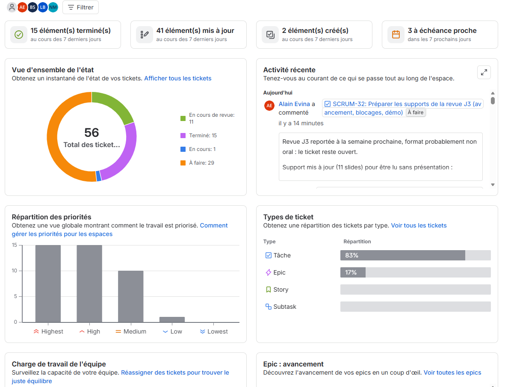

# Preuves du mi-parcours — SCRUM-17

## Site du projet — SCRUM-23

Le site est en ligne depuis le 23/10/2026 (fusion de la PR #28 `dev` → `main`, workflow « Déploiement volet A » réussi) :
**https://lindaboukhit.github.io/TeamAI/**

Il charge le BiLSTM v1 entraîné (SCRUM-25), le vocabulaire C2 et le prétraitement JavaScript (SCRUM-26), puis exécute l'inférence dans le navigateur, sans serveur. Le parcours complet (saisie des logs, import, export CSV) arrive avec SCRUM-27.

## Première inférence — SCRUM-28

Le modèle SmolLM2-1.7B-Instruct a été exécuté sur un extrait de logs HDFS.

- Bloc utilisé : `blk_8362325295506522506` (25 lignes).
- Temps de chargement : 238 secondes.
- Génération : 156 tokens en 952,03 secondes (0,16 token par seconde).
- Mémoire maximale : 9,84 GiB au chargement et 8,00 GiB pendant la génération.

[Voir la réponse brute du modèle](../../eval/results/SCRUM-28/output.txt)  
[Voir le rapport et les autres preuves](../../eval/results/SCRUM-28/README.md)

Cet essai porte sur un seul bloc : il ne suffit pas à évaluer la qualité générale du modèle.

## Version 4 bits du modèle — SCRUM-57

La lenteur de la première inférence a conduit à tester la version quantifiée officielle du modèle (GGUF Q4_K_M, llama.cpp), comparée au modèle complet (float32) sur le même bloc, avec les mêmes paramètres et sur la même machine (06/10, sans GPU).

| Mesure | float32 | 4 bits (Q4_K_M) |
|---|---|---|
| Taille sur disque | 3,4 Go | 0,98 Go |
| Chargement | 24 s | 2,9 s |
| Mémoire après chargement / pic | 6,8 Go / 16,1 Go | 2,3 Go / 2,8 Go |
| Génération | 0,64 token/s | 1,9 token/s |

- La version 4 bits est retenue comme candidate pour la démonstration et les évaluations : environ 3 fois plus rapide et beaucoup moins gourmande en mémoire sur cette trace.
- Limites : une seule trace et une seule exécution par version ; relancée le 13/10 sur une machine chargée, la version 4 bits donne la même réponse à 0,71 token/s. Ce sont des observations, pas une comparaison contrôlée.
- Reste à faire : brancher cette version derrière `generate()` et la comparer sur plusieurs traces de validation (SCRUM-38).

Détail et constat sur l'ordre du prompt : [journal du projet](journal.md), entrée « Version 4 bits du SLM » ; code : [`volet_b/slm/bench_gguf.py`](../../volet_b/slm/bench_gguf.py).

## Capture du board Jira

Capture reprise du support J3 (SCRUM-32). Board : https://lindaboukhit04.atlassian.net/jira/software/projects/SCRUM/boards/1

## Livraison

- Site en ligne : https://lindaboukhit.github.io/TeamAI/ (23/10/2026).
- Tag `v0.1-mi-parcours` sur `main` : https://github.com/LindaBOUKHIT/TeamAI/releases/tag/v0.1-mi-parcours
- Branche `milestone/mi-parcours` pour consultation : https://github.com/LindaBOUKHIT/TeamAI/tree/milestone/mi-parcours
- Capture du board : ci-dessus.
- Courriel au professeur : à envoyer.

## Soutenance du lundi 30 novembre 2026 · SCRUM-54

État du dossier le vendredi 27 novembre. Le lot de remise comprend le pitch, la présentation de la PR #86, le rapport V1 et une vidéo de secours en pièce jointe. La présentation reste soumise à la revue de la PR.

| Élément | Version ou preuve vérifiée | Reste pour la remise |
|---|---|---|
| Site du volet A | [Site public](https://lindaboukhit.github.io/TeamAI/) testé le 27/11. Edge et Chromium ont chargé le modèle et produit les cinq résultats attendus. [Résultats bruts des dix essais](verification_site/recette_j4_2026-11-27.json) | Rejouer la recette du samedi 28/11 (J−2) et après toute nouvelle mise en production. |
| Pitch | [PDF de 6 pages](https://github.com/LindaBOUKHIT/TeamAI/blob/dc9d9d93e112862593649c463e99e847ce5e4eb1/docs/soutenance/pitch.pdf) | Joindre au courriel. |
| Présentation | [PDF de 12 pages](https://github.com/LindaBOUKHIT/TeamAI/blob/0c225475c2e9a142d2a8b9717993a3b9240c68e6/docs/soutenance/presentation.pdf) de la [PR #86](https://github.com/LindaBOUKHIT/TeamAI/pull/86). La diapo 7 présente les mesures automatiques sur 80 cas. Aucun résultat de justesse issu de l’arbitrage humain n’y est publié. | Faire relire et intégrer cette version, puis envoyer le PDF correspondant. |
| Rapport V1 | [PDF de 32 pages](https://github.com/LindaBOUKHIT/TeamAI/blob/dc9d9d93e112862593649c463e99e847ce5e4eb1/docs/rapport/TeamAI_Rapport_V1.pdf) disponible avant J4 | L’envoi antérieur au professeur reste à confirmer. |
| Secours volet B | `demo_volet_b.mp4` (3 min 06 s), restitution du [parcours de validation à trois agents](https://github.com/LindaBOUKHIT/TeamAI/tree/dc9d9d93e112862593649c463e99e847ce5e4eb1/eval/results/SCRUM-42/kaggle_val5_v3/seed7). La vidéo montre les quatre lignes du bloc, la réponse et le rejet par le contrôleur, en configuration de base. SHA-256 `26fb116e0d9a5137db432c45f0a0056dab880eb5d3d790373769c2b893a81c4d`. | Fichier hors Git à joindre au courriel. L’enregistrement de l’interface en configuration adaptée relève de SCRUM-51. |
| Dépôt et version de soutenance | [Dépôt accessible en lecture publique](https://github.com/LindaBOUKHIT/TeamAI). La [PR #81 de dev vers main](https://github.com/LindaBOUKHIT/TeamAI/pull/81) est ouverte. Seul le tag de mi-parcours est publié au 27/11. | Après intégration des livrables, revue d’Alain et fusion de la PR finale, poser `v1.1-soutenance` sur le commit de fusion. |
| Suivi | [Board Jira](https://lindaboukhit04.atlassian.net/jira/software/projects/SCRUM/boards/1), [capture datée du jalon J3](../soutenance/j3/board.png), [classeur](https://docs.google.com/spreadsheets/d/1W8IjMS2L9-SxDK-FGQvjVIdG9NSwmwVBR8dpT5AitLg/edit?gid=1148275204#gid=1148275204) et [journal du projet](https://github.com/LindaBOUKHIT/TeamAI/blob/dc9d9d93e112862593649c463e99e847ce5e4eb1/docs/projet/journal.md). L’export anonyme du classeur a répondu HTTP 401. | Vérifier que le compte du destinataire peut consulter le classeur et le board, ou fournir une capture actuelle du board. |

Pour la recette du 28/11, ouvrir le site et lancer les cinq exemples. Le résultat attendu est de 0 bloc suspect sur 1 pour « Bloc normal », 1 sur 1 pour « Bloc avec anomalie », 1 sur 3 pour « Plusieurs blocs », 0 sur 1 pour « Bloc incomplet » et 1 sur 1 avec 2 lignes ignorées pour « Lignes invalides ». [Procédure de recette](verification_site.md)

Les dates d’envoi, l’accès du destinataire et le lien du tag pourront être consignés ici après vérification.
