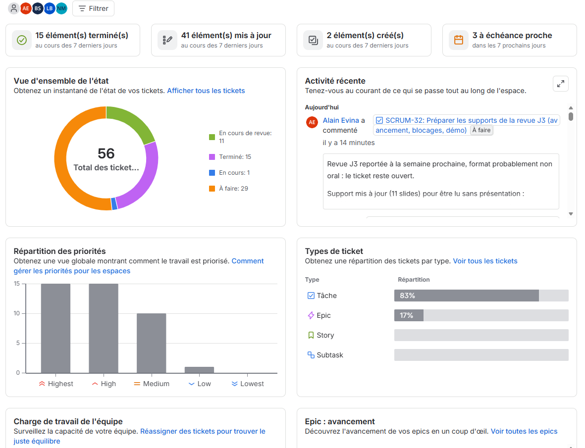

# Preuves du mi-parcours — SCRUM-17

## Site du projet — SCRUM-23

Le site est en ligne depuis le 23/10/2026 (fusion de la PR #28 `dev` → `main`, workflow « Déploiement volet A » réussi) :
**https://lindaboukhit.github.io/TeamAI/**

Il charge le BiLSTM v1 entraîné (SCRUM-25), le vocabulaire C2 et le prétraitement JavaScript (SCRUM-26), puis exécute l'inférence dans le navigateur, sans serveur. Le parcours complet (saisie des logs, import, export CSV) arrive avec SCRUM-27.

## Première inférence — SCRUM-28

Le modèle SmolLM2-1.7B-Instruct a été exécuté sur un extrait de logs HDFS.

- Bloc utilisé : `blk_8362325295506522506` (25 lignes).
- Temps de chargement : 238 secondes.
- Génération : 156 tokens en 952,03 secondes (0,16 token par seconde).
- Mémoire maximale : 9,84 GiB au chargement et 8,00 GiB pendant la génération.

[Voir la réponse brute du modèle](../../eval/results/SCRUM-28/output.txt)  
[Voir le rapport et les autres preuves](../../eval/results/SCRUM-28/README.md)

Cet essai porte sur un seul bloc : il ne suffit pas à évaluer la qualité générale du modèle.

## Version 4 bits du modèle — SCRUM-57

La lenteur de la première inférence a conduit à tester la version quantifiée officielle du modèle (GGUF Q4_K_M, llama.cpp), comparée au modèle complet (float32) sur le même bloc, avec les mêmes paramètres et sur la même machine (06/10, sans GPU).

| Mesure | float32 | 4 bits (Q4_K_M) |
|---|---|---|
| Taille sur disque | 3,4 Go | 0,98 Go |
| Chargement | 24 s | 2,9 s |
| Mémoire après chargement / pic | 6,8 Go / 16,1 Go | 2,3 Go / 2,8 Go |
| Génération | 0,64 token/s | 1,9 token/s |

- La version 4 bits est retenue comme candidate pour la démonstration et les évaluations : environ 3 fois plus rapide et beaucoup moins gourmande en mémoire sur cette trace.
- Limites : une seule trace et une seule exécution par version ; relancée le 13/10 sur une machine chargée, la version 4 bits donne la même réponse à 0,71 token/s. Ce sont des observations, pas une comparaison contrôlée.
- Reste à faire : brancher cette version derrière `generate()` et la comparer sur plusieurs traces de validation (SCRUM-38).

Détail et constat sur l'ordre du prompt : [journal du projet](journal.md), entrée « Version 4 bits du SLM » ; code : [`volet_b/slm/bench_gguf.py`](../../volet_b/slm/bench_gguf.py).

## Capture du board Jira

Capture reprise du support J3 (SCRUM-32). Board : https://lindaboukhit04.atlassian.net/jira/software/projects/SCRUM/boards/1

## Livraison

- Site en ligne : https://lindaboukhit.github.io/TeamAI/ (23/10/2026).
- Tag `v0.1-mi-parcours` sur `main` : https://github.com/LindaBOUKHIT/TeamAI/releases/tag/v0.1-mi-parcours
- Branche `milestone/mi-parcours` pour consultation : https://github.com/LindaBOUKHIT/TeamAI/tree/milestone/mi-parcours
- Capture du board : ci-dessus.
- Courriel au professeur : à envoyer.