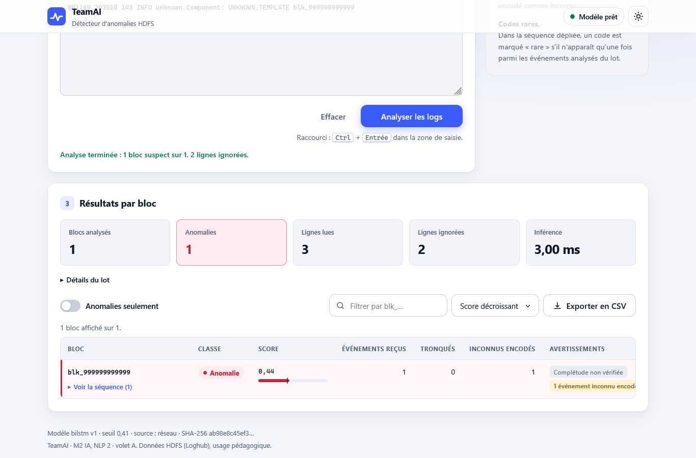
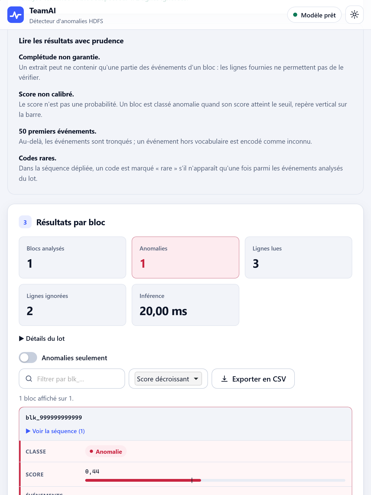
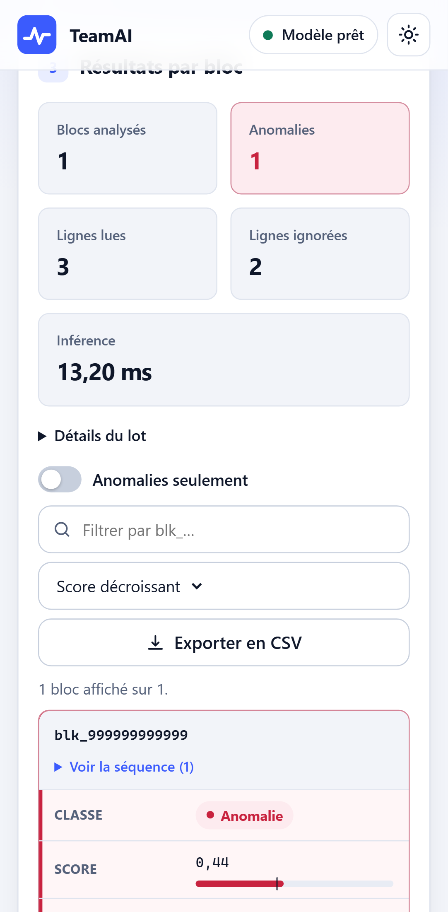
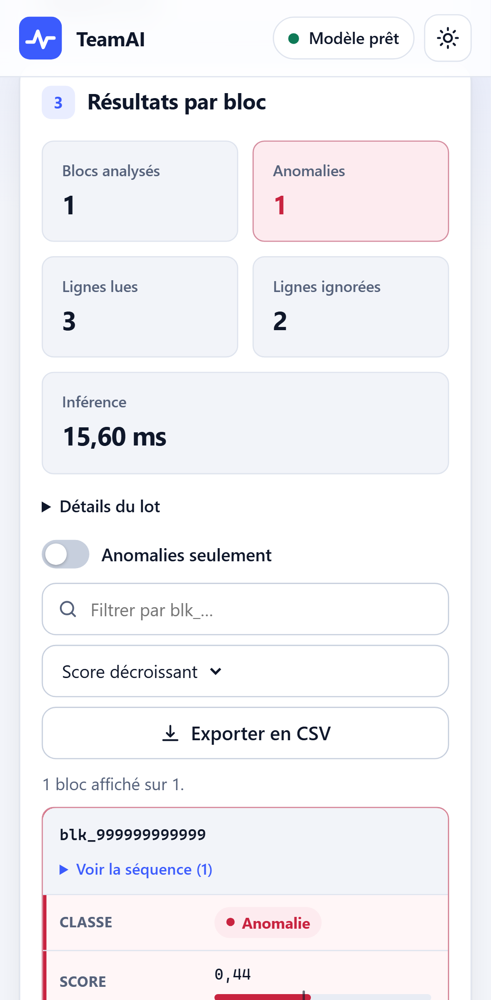

# Vérification du site en production (SCRUM-50)

**Date** : mercredi 25/11/2026.
**URL** : https://lindaboukhit.github.io/TeamAI/ (volet A, détecteur BiLSTM en ONNX exécuté dans le navigateur).
**Version servie** : build de `main` au commit `91ce21b` (fusion de la PR #70), déployé le 24/11/2026 à 12 h 30 UTC par le workflow « Déploiement volet A » (run 45393963301, succès). En-tête `Last-Modified` : `Tue, 24 Nov 2026 12:30:45 GMT`.

**Verdict** : le site fonctionne sur les 9 configurations testées, sans erreur console ni requête en échec. Un défaut d'affichage sur mobile a été trouvé et corrigé dans la PR SCRUM-50 (section 5). Il reste une recette signée par un autre membre (Nassim) et la livraison `dev` → `main` + tag (section 7).

## 1. Ce qui est servi est-il à jour ?

Oui pour le volet A.

- `git log origin/main..origin/dev` : 5 commits (PR #67, SCRUM-42). Ils touchent `volet_b/`, `tests/`, `eval/` et `docs/projet/journal.md`, aucun fichier de `volet_a/web/`.
- `git diff origin/main origin/dev -- volet_a/web` : vide.
- Build local de `volet_a/web` depuis `origin/dev` (`npm ci`, `npm test` : 20 tests passent, `npm run build`), comparé aux fichiers servis téléchargés sans cache : les 8 fichiers sont identiques octet pour octet.

| Fichier servi | Taille | SHA-256 (12 premiers) | Build local |
|---|---:|---|---|
| `index.html` | 14 586 o | `f9ea485486e1` | identique |
| `assets/index-q-S7YBMt.js` | 14 786 o | `33c738f92ab5` | identique |
| `assets/index-BgFHaD2p.css` | 19 184 o | `93e7a41b395f` | identique |
| `assets/worker-r6SCPeh1.js` | 74 304 o | `0b2c2aab722b` | identique |
| `assets/ort-wasm-simd-threaded-DcHrbrbl.wasm` | 14 239 897 o | `3398c10d07d2` | identique |
| `model/detector.onnx` | 56 806 o | `ab98e8c45ef3` | identique |
| `model/detector.meta.json` | 905 o | `92f8b642587e` | identique |
| `vocab.json` | 5 193 o | `77b6688a94a0` | identique |

Checklist du ticket (alignement du 13/10) :

- [x] Modèle servi entraîné : `detector.meta.json` au schéma C3 (`model: bilstm`, `run_id 20261016T184412Z_4f3011f2_bilstm`, macro-F1 val 0,9939, seuil 0,4081 choisi sur la validation, SCRUM-62), pas de `trained_on: none-random-weights`.
- [x] `vocab.json` C2 présent ; son SHA-256 et celui du modèle correspondent à ceux des métadonnées (contrôle fait aussi par le site au chargement).
- [x] `npm run build` fonctionne (Node 24.12.0, Vite 8).
- [x] CI verte sur `dev` (workflow Tests, commit `20d0053`).
- [x] Exemples issus de la validation (5 fichiers `examples/0*.log`).

## 2. Environnements de test

| Configuration | Moteur et version | Fenêtre |
|---|---|---|
| Navigateur intégré à l'application Claude (test manuel) | Chromium 156.0.8078.100 | 1024 × 768, puis 375 × 812 et 768 × 1024 |
| `chromium-desktop` | Chromium 159.0.8154.6 (Playwright 1.65.1) | 1366 × 900 |
| `edge-desktop` | Microsoft Edge 158.0.4370.33 installé | 1366 × 900 |
| `firefox-desktop` | Firefox 159.0 (Playwright) | 1366 × 900 |
| `webkit-desktop` | WebKit 27.2 (moteur de Safari, Playwright) | 1366 × 900 |
| `webkit-iphone` | WebKit 27.2, profil iPhone 13 | 390 × 664, tactile |
| `chromium-pixel` | Chromium 159, profil Pixel 7 | 412 × 839, tactile |
| `webkit-ipad` | WebKit 27.2, profil iPad (gen 7) | 810 × 1080, tactile |
| `firefox-mobile-375` | Firefox 159.0 | 375 × 812 |
| `chromium-3g` | Chromium 159, profil « Fast 3G » (1,6 Mbit/s, 562 ms de latence) | 1366 × 900 |

Chaque configuration Playwright démarre dans un contexte neuf, sans cache ni stockage : c'est l'équivalent d'une navigation privée. Dans le navigateur intégré, le cache du modèle (`teamai-models-v1`) a été vidé puis la page rechargée.

Script : [`verification_site/recette.mjs`](verification_site/recette.mjs) ; résultats bruts : [`recette_production.json`](verification_site/recette_production.json).

## 3. Ce qui marche

**Chargement.** Statut « Modèle prêt » dans les 9 configurations, 0 erreur ou avertissement console, 0 réponse HTTP ≥ 400, 0 requête en échec.

| Configuration | Modèle prêt après |
|---|---:|
| Chromium bureau | 618 ms |
| Edge bureau | 875 ms |
| Firefox bureau | 1 331 ms |
| WebKit bureau | 671 ms |
| iPhone 13 (WebKit) | 902 ms |
| Pixel 7 (Chromium) | 701 ms |
| iPad (WebKit) | 741 ms |
| Firefox 375 px | 1 377 ms |
| Connexion lente « Fast 3G », cache vide | 22 130 ms |
| Navigateur intégré, cache du modèle vidé | 2 890 ms |

Première visite : 3,8 Mo transférés, dont 3,72 Mo pour le moteur WebAssembly d'onnxruntime (14,24 Mo décompressés, servi en gzip). Les visites suivantes lisent le modèle dans le cache du navigateur (« source : cache navigateur » en pied de page). Sur connexion lente, le statut « Chargement du modèle… » reste affiché pendant les 22 s.

**Inférence sur les exemples.** Résultats identiques dans les 9 configurations :

| Exemple | Blocs | Anomalies | Lignes lues | Lignes ignorées | Score |
|---|---:|---:|---:|---:|---|
| Bloc normal | 1 | 0 | 27 | 0 | 0,00 |
| Bloc avec anomalie | 1 | 1 | 4 | 0 | 1,00 |
| Plusieurs blocs | 3 | 1 | 60 | 0 | 1,00 ; 0,00 ; 0,00 |
| Bloc incomplet | 1 | 0 | 13 | 0 | 0,00, avertissement « exemple volontairement incomplet » |
| Lignes invalides | 1 | 1 | 3 | 2 | 0,44, 1 événement inconnu |

Temps d'inférence affiché : de 0,7 à 49,5 ms selon l'exemple et le navigateur (premier appel le plus lent).

**Autres fonctions vérifiées (navigateur intégré).** Export CSV de « Plusieurs blocs » : fichier `teamai-resultats-hdfs.csv`, en-tête et 3 lignes avec score, seuil `0.40814146399497986` et hash du modèle. Bascule thème clair / sombre.

**Affichage mobile et tablette.** Aucun débordement horizontal (largeur du document = largeur de la fenêtre) à 375, 390, 412, 768, 810 et 1366 px. Sous 768 px, le tableau passe en cartes par bloc ; les en-têtes de colonnes masqués qui dépassent sont dans un conteneur `overflow: hidden` et ne créent pas de défilement.

| Firefox bureau | iPad (WebKit) |
|---|---|
|  |  |

## 4. Ce qui échoue

Un seul défaut, présent en production :

**Sur mobile, le titre « Résultats par bloc » passe sous la barre supérieure après l'analyse.** Mesure (`verification_site/defilement.mjs`), après le défilement automatique vers les résultats :

| Fenêtre | Bas de la barre supérieure | Haut de la section attendu (`scroll-margin-top`) | Haut de la section mesuré |
|---|---:|---:|---:|
| Pixel 7, 412 px | 65 px | 80 px | 56 px |
| iPhone 13, 390 px | 65 px | 80 px | 56 px |

Cause : `main.js` lance `scrollIntoView` sur la section des résultats, puis le bloc `finally` masque la barre de progression située au-dessus. La page remonte de 24 px après le calcul de la cible. Aucune erreur JavaScript n'est levée.

Constats sans conséquence :

- Les pages de mise au point `spike.html`, `threshold.html` et `scrum44-parity.html` existent dans `volet_a/web/` mais ne sont pas publiées (404) : seule `index.html` est une entrée du build Vite. C'est voulu.
- Le moteur WebKit de Playwright sous Windows n'applique pas `backdrop-filter` : le texte reste lisible à travers la barre supérieure translucide dans ses captures. Le CSS servi contient bien `-webkit-backdrop-filter` pour Safari.

## 5. Correctif (PR SCRUM-50 vers `dev`)

`volet_a/web/src/main.js` : la barre de progression est masquée avant le défilement (`setProgress(0, 0)` avant `scrollIntoView`). Le bloc `finally` reste inchangé pour les cas d'erreur.

Testé localement (`npm test` : 20/20 ; `npm run build` ; `vite preview` sur `http://localhost:4179/TeamAI/`) :

| Fenêtre | Haut de la section, avant | Après |
|---|---:|---:|
| Pixel 7 | 56 px | 80 px |
| iPhone 13 | 56 px | 80 px |
| iPad | 472 px | 496 px |
| Bureau 1366 px | 388 px | 412 px |

La recette complète rejouée sur le build corrigé donne les mêmes résultats d'inférence, 0 erreur console et aucun débordement ([`recette_correctif.json`](verification_site/recette_correctif.json)).

| Pixel 7, production (avant) | Pixel 7, correctif (après) |
|---|---|
|  |  |

Le correctif n'est en ligne qu'après la livraison `dev` → `main` (section 7).

## 6. Limites de GitHub Pages

- Site publié : 14,5 Mo, très loin de la limite de 1 Go. Plus gros fichier : 14,2 Mo (moteur WebAssembly), sous la limite de 100 Mo par fichier de GitHub.
- Bande passante : limite souple de 100 Go par mois, soit environ 26 000 premières visites à 3,8 Mo. Aucun risque pour la soutenance.
- En-tête `Cache-Control: max-age=600` : après un redéploiement, un visiteur peut voir l'ancienne version pendant 10 minutes au plus. Le modèle est identifié par son hash, donc jamais servi périmé.

## 7. Non testé

- Safari réel sur iPhone, iPad ou Mac (pas d'appareil Apple) : couvert par le moteur WebKit de Playwright, qui n'est pas Safari. À faire par un membre équipé d'un iPhone.
- Téléphone Android réel : couvert par l'émulation Pixel 7 de Chromium.
- Firefox 160.0.1 installé sur la machine : le test utilise Firefox 159.0 de Playwright.

## 8. Procédure de livraison v1.0 (après fusion des PR du volet B)

À faire une fois SCRUM-35, 36, 39 et 45 fusionnées dans `dev`, ainsi que la PR SCRUM-50. Aucun changement fonctionnel après cette livraison : seulement des correctifs via `fix/SCRUM-<n>-…` → `dev` → `main`.

1. Vérifier `dev` :
   ```powershell
   git fetch origin
   gh run list --branch dev --workflow tests.yml -L 1
   git log --oneline origin/main..origin/dev
   git diff --stat origin/main origin/dev -- volet_a/web
   ```
   La dernière exécution de Tests doit être verte sur le dernier commit de `dev`.
2. Ouvrir la PR de publication et la faire relire par Nassim :
   ```powershell
   gh pr create --repo LindaBOUKHIT/TeamAI --base main --head dev --title "Release v1.0" --body "Livraison v1.0 : volet A (site, correctif SCRUM-50) et volet B. Recette : docs/projet/verification_site.md."
   ```
3. Après approbation, fusionner avec un commit de fusion, comme les PR #28, #58 et #70 (pas de squash, pour garder l'historique de `dev`) :
   ```powershell
   gh pr merge <numéro> --repo LindaBOUKHIT/TeamAI --merge
   ```
4. Le push sur `main` lance « Déploiement volet A » si `volet_a/web/**` a changé (c'est le cas avec le correctif SCRUM-50). Suivre le run :
   ```powershell
   gh run list --repo LindaBOUKHIT/TeamAI --workflow deploy-volet-a.yml -L 1
   ```
   En cas d'échec d'artefact (déjà vu le 24/11), relancer : `gh run rerun <id> --failed`, ou `gh workflow run deploy-volet-a.yml --ref main`.
5. Revérifier la production, au moins 10 minutes après le déploiement (cache de 600 s) :
   Depuis un dossier hors du dépôt contenant une copie des deux scripts :
   ```powershell
   npm i playwright; npx playwright install chromium firefox webkit; node recette.mjs; node defilement.mjs
   ```
   `recette.mjs` écrit `out/recette.json` et une capture par configuration ; la configuration Edge exige Edge installé.
   Attendu : mêmes tableaux qu'en section 3, haut de la section des résultats à 80 px sur Pixel 7 et iPhone 13. Mettre à jour ce document avec la date, le commit de `main` et le numéro du run.
6. Poser le tag annoté sur le commit de fusion et publier la release :
   ```powershell
   git fetch origin
   git tag -a v1.0 origin/main -m "v1.0 : livraison pour la soutenance du 30/11/2026"
   git push origin v1.0
   gh release create v1.0 --repo LindaBOUKHIT/TeamAI --verify-tag --title "v1.0" --notes "Site du volet A : https://lindaboukhit.github.io/TeamAI/"
   ```
   Le ticket prévoyait `v1.0-volet-a` ; un seul tag `v1.0` suffit si le volet B est livré dans la même fusion.
7. Faire signer la recette par un autre membre (Nassim) : relecture de ce document et essai sur son téléphone, puis passer SCRUM-50 à « Terminé ».

Échéance : avant le samedi 28/11/2026 (vérification des URL 48 h avant la soutenance du lundi 30/11).
