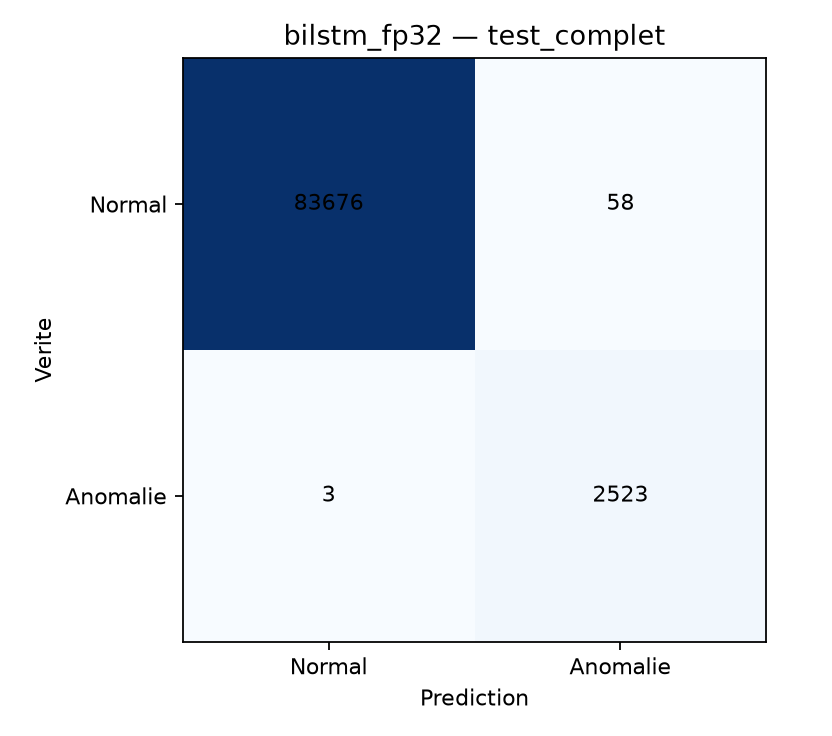

# TEAMAI — Rapport du projet NLP 2

Détection et aide à l’interprétation d’anomalies dans les journaux HDFS

Master 2 Data & Intelligence Artificielle  
Alain Evina · Bachar Ben Slama · Linda Boukhit · Nassim Mezzai

**Version 1 — 25/11/2026**

Les chapitres 1 et 2 reprennent le texte du V0.1 de Linda (SCRUM-33), avec remise en forme et actualisations factuelles. Source de ces deux chapitres : [rapport V0.1](TeamAI_Rapport_SCRUM33_V0.1.pdf). Chaque chiffre des chapitres suivants est rattaché à sa source, et les contenus issus de PR non fusionnées sont signalés « en relecture, PR #n ».

## 1. Introduction et cadrage du projet

### 1.1 Contexte et problématique

Les systèmes informatiques distribués produisent de nombreux journaux d’événements (logs) qui retracent leur fonctionnement. Leur analyse permet de repérer des comportements inhabituels et d’aider à l’investigation d’incidents. Dans Hadoop Distributed File System (HDFS), les séquences d’événements associées aux blocs constituent une source d’information exploitable pour la détection d’anomalies.

Le projet TeamAI explore deux approches complémentaires : la classification automatique de traces HDFS à l’aide d’un modèle entraîné par l’équipe, puis l’aide à l’interprétation à partir d’un petit modèle de langage préentraîné, adapté et enrichi de documentation.

Problématique : comment détecter des anomalies dans les journaux HDFS et proposer une interprétation exploitable, tout en comparant la qualité, les ressources et le degré de maîtrise de deux approches d’intelligence artificielle ?

### 1.2 Objectifs

- Préparer un corpus HDFS reproductible et documenter ses partitions.
- Développer un classifieur normal/anomalie et le comparer à une baseline simple.
- Déployer une application web publique exécutant le modèle dans le navigateur, sans serveur d’inférence payant.
- Expérimenter un SLM local, son adaptation LoRA, un RAG documentaire et une organisation multi-agents.
- Comparer coût, latence, qualité, contrôle, explicabilité et dépendance fournisseur.

### 1.3 Périmètre

| Volet A — application web | Volet B — application locale |
|---|---|
| Classification binaire de traces HDFS complètes. Modèle BiLSTM envisagé, export ONNX et inférence dans le navigateur. | Interprétation de traces à l’aide d’un SLM open-weights, d’une adaptation LoRA, de récupération documentaire (RAG) et d’agents spécialisés. |
| Entrée : logs HDFS au format documenté. Sortie : classe et résultat exportable. | Entrée : trace HDFS. Sortie : analyse distinguant faits, hypothèses et informations manquantes, avec sources. |

Hors périmètre : supervision temps réel, collecte sur infrastructure de production, prise en charge de tous les formats de logs, correction automatique d’incidents et diagnostic causal garanti. Les deux applications restent utilisables indépendamment.

### 1.4 Hypothèses et contraintes

- Le corpus HDFS_v1 permet de construire des ensembles d’apprentissage, validation et test pertinents ; les déséquilibres et séquences répétées doivent être examinés.
- Le volet A doit respecter un budget d’hébergement nul et réaliser l’inférence côté client.
- Le volet B dépend du matériel disponible : la machine cible est désormais celle de Nassim, avec une RTX 3050 Laptop de 6 Go. Actualisation SCRUM-63 : journal de branche, entrée du 27/10/2026 (fusionné, PR [#41](https://github.com/LindaBOUKHIT/TeamAI/pull/41)) et trace SCRUM-63 (fusionné, PR [#40](https://github.com/LindaBOUKHIT/TeamAI/pull/40)). Le [relevé matériel](../projet/environnements.md) confirme ce GPU.
- Les évaluations doivent distinguer observations expérimentales, hypothèses et fonctionnalités encore prévues.

### 1.5 Risques et réponses prévues

| Risque | Réponse prévue |
|---|---|
| Fuite de données ou performance surestimée | Séparer par bloc, contrôler les répétitions, réserver le test final et rapporter les résultats sur séquences inédites. |
| Incompatibilité ou lenteur du modèle web | Vérifier tôt la parité Python / ONNX Runtime Web, puis optimiser la taille et le chargement. |
| SLM trop lent ou trop gourmand | Mesurer CPU/RAM/latence ; tester la quantification et, si nécessaire, des ressources GPU pour l’adaptation. |
| Interprétations non fiables | Évaluer les faits et les sources ; intégrer RAG, contrôle et possibilité d’abstention. |
| Retards et dépendances entre tâches | Utiliser Jira, des responsables identifiés, des revues croisées et un journal des décisions. |

### 1.6 Critères de réussite

- Application A publique, fonctionnelle, exécutant réellement un modèle dans le navigateur.
- Préparation des données reproductible et métriques finales sur un test réservé : précision, rappel, macro-F1 et matrice de confusion.
- Application B locale fournissant des interprétations sourcées et explicitant ses incertitudes.
- Adaptation effective du SLM, comparaison avant/après et mesure de l’apport du RAG et des agents.
- Scripts, configurations, décisions et limites suffisamment documentés pour reproduire les démonstrations.

Ces critères décrivent les objectifs du projet ; ils ne constituent pas des résultats déjà atteints.

## 2. Organisation et méthodologie

### 2.1 Équipe et responsabilités

| Membre | Domaine principal | Contribution croisée |
|---|---|---|
| Nassim Mezzai | Audit HDFS, parsing, splits et évaluation | Relecture des données et du classifieur |
| Bachar Ben Slama | Classification, export ONNX, application web | Contrôle des données et tests navigateur |
| Alain Evina | SLM, adaptation LoRA, expérimentation et rapport | Relecture du RAG et des agents |
| Linda Boukhit | Corpus documentaire, RAG, orchestration et interface locale | Évaluation et coordination des interfaces |

Cette répartition est issue du cadrage initial et de la feuille de route ; elle doit être ajustée aux contributions effectivement réalisées et validée par le groupe.

### 2.2 Planification et jalons

| Jalon | Date | Attendu |
|---|---|---|
| J2 | 21/09/2026 | Cadrage, étude des volets et organisation. |
| Mi-parcours | 01/10/2026 | Version minimale du volet A et première inférence locale. |
| J3 | 16/10/2026 | Volet A fonctionnel, adaptation engagée, supports préparés, rapport commencé. |
| Rapport V1 (interne) | Fin novembre 2026 | Consolidation du PDF et des expériences. |
| J4 — soutenance | 30/11/2026 | Présentation et démonstration des deux volets. |

Le jalon de mi-parcours a été déclaré non tenu dans la feuille de route du 6 octobre. Un sprint de rattrapage a donc été planifié. Cette situation doit être décrite sans confondre les objectifs initiaux avec les livrables effectivement disponibles.

### 2.3 Pilotage, Git et traçabilité

L’équipe utilise Jira pour structurer les tâches en epics et sprints, avec responsable, relecteur et critère de fin. Le dépôt GitHub TeamAI conserve les scripts, la documentation et les preuves expérimentales. La branche main est destinée à la production ; dev sert à l’intégration ; les travaux sont développés sur des branches dédiées aux tickets et soumis par Pull Request.

Les décisions et les expériences sont consignées dans docs/projet/journal.md. La feuille de route rappelle que Jira constitue la source de vérité pour l’état des tâches. Le journal consulté ne contient pas encore de compte rendu de réunion attesté : les pratiques collectives devront donc être documentées avec précision plutôt que supposées.

### 2.4 Préparation du corpus HDFS

La préparation s’appuie sur HDFS_v1 (Loghub). Les lignes brutes sont associées à des identifiants de blocs (blk_) puis transformées en séquences d’événements, issues de 29 templates. L’audit, le parsing et la séparation apprentissage/validation/test ont fait l’objet de travaux spécifiques.

Le protocole retenu sur dev sépare les blocs de manière stratifiée ; il signale également les séquences inédites (unseen_seq) afin de compléter l’interprétation des métriques. Les exemples publics de l’application doivent provenir de la validation et non du test réservé. Le test final n’est pas utilisé pour régler les modèles.

### 2.5 Développement et évaluation du volet A

La démarche compare d’abord une baseline simple à un modèle BiLSTM, puis vérifie l’export ONNX et la cohérence de l’inférence entre Python et le navigateur. Les mesures pertinentes comprennent précision, rappel, macro-F1, faux positifs, faux négatifs, taille du modèle et latence côté client.

Une baseline par régression logistique est documentée dans SCRUM-24. Un essai de parité Python / navigateur a été mené sur un BiLSTM jouet à poids aléatoires : il vérifie la compatibilité technique de l’export, mais ne démontre pas les performances du modèle final entraîné.

### 2.6 Développement et évaluation du volet B

Le volet B commence par une inférence locale avec SmolLM2-1.7B-Instruct, puis examine la quantification, l’adaptation LoRA, l’intégration du RAG et l’intérêt d’agents de recherche, rédaction et contrôle. Les comparaisons prévues doivent utiliser des jeux réservés et un protocole comparable, en mesurant notamment la fidélité aux faits, la pertinence des sources, l’abstention, la latence et la mémoire.

Actualisation : le modèle courant devient Gemma 4 E4B QAT sous llama.cpp (SCRUM-63), avec la machine de Nassim pour cible ; l’adaptateur LoRA complet a été entraîné sur T4 Kaggle puis appliqué au modèle quantifié, et les quatre configurations (base ou LoRA, 1 ou 3 agents) ont été mesurées sur le test réservé (SCRUM-39 et SCRUM-45, 3.3.6). L’inférence sur la RTX 3050 reste à mesurer. Sources : trace SCRUM-63 (fusionné, PR [#40](https://github.com/LindaBOUKHIT/TeamAI/pull/40)) et journal SCRUM-29, entrée du 08/11/2026 (fusionné, PR [#23](https://github.com/LindaBOUKHIT/TeamAI/pull/23)).

Les premières expériences montrent des temps de génération élevés sur CPU et des interprétations incomplètes ou inventées. Un essai GGUF 4 bits a réduit la mémoire observée et amélioré le débit dans une configuration donnée, mais le journal précise que ces mesures ne constituent pas une comparaison contrôlée. Les conclusions devront être confirmées sur plusieurs traces.

### 2.7 Reproductibilité et limites

Chaque expérience doit documenter la date, le responsable, le code, les données, les paramètres, la machine, les résultats et les erreurs. Les métriques finales, la validation collective des choix et les retours d’expérience individuels seront ajoutés après vérification. Aucune conclusion générale ne doit être tirée d’une seule trace ou d’un essai de faisabilité.

## 3. Présentation des solutions développées

### 3.1 Volet A — classification et application web

**Rédaction : Alain, à partir des sources du dépôt, à la place de la section attendue de Bachar. À relire par Bachar.**

**Chaîne de traitement.** Les lignes de logs sont regroupées par identifiant de bloc `blk_…`. Chaque ligne est associée à l'un des 29 modèles d'événements HDFS (E1 à E29). Le vocabulaire compte 31 indices : 0 pour le remplissage, 30 pour un événement inconnu. Le modèle lit les **50 premiers** événements de chaque bloc ; au-delà, ils sont tronqués et le site le signale. Le même prétraitement est écrit en Python pour l'entraînement et en JavaScript pour le site, et des cas de parité le vérifient. Sources : `volet_a/training/dataset.py`, `volet_a/web/src/preprocess.js`, `volet_a/web/public/model/parity_cases.json`.

**Modèle (SCRUM-25).** Un embedding de dimension 16 alimente un LSTM bidirectionnel de 32 unités par sens. Les sorties sont moyennées sur les seules positions réelles, puis une couche linéaire et une sigmoïde donnent un score `p_anomaly` entre 0 et 1. L'entraînement dure 5 époques, avec des lots de 512, un taux d'apprentissage de 0,001 et la graine 42. Il prend environ 6 minutes sur CPU, validation comprise. Le modèle est exporté en ONNX selon le contrat C3 : entrée `event_ids` de forme [lot, 50], sortie `p_anomaly` de forme [lot]. Le fichier FP32 pèse **56 806 octets**. Sources : `volet_a/training/bilstm.py`, `volet_a/training/train.py`, [métriques SCRUM-25](../../eval/results/SCRUM-25-bilstm-v1/metrics.json), [contrats](../contrats.md).

**Seuil (SCRUM-62).** Le seuil **0,4081** a été choisi sur la validation pour ne manquer presque aucune anomalie, au prix de fausses alertes supplémentaires (§3.3.5). Il est figé depuis et appliqué tel quel sur le test.

**Test officiel (SCRUM-44).** Le test est ouvert une seule fois, sur **86 260** blocs, avec le seuil figé.

| Modèle | Population | Macro-F1 | Fausses alertes | Anomalies manquées |
|---|---|---:|---:|---:|
| Baseline (régression logistique) | Test complet | 0,9882 | 116 | 2 |
| BiLSTM FP32 | Test complet | **0,9938** | **58** | 3 |
| Baseline | 1 962 blocs à séquence inédite | 0,9576 | 67 | 2 |
| BiLSTM FP32 | 1 962 blocs à séquence inédite | **0,9714** | **43** | 3 |

Le BiLSTM divise par deux les fausses alertes sur le test complet, pour une anomalie manquée de plus. Les versions FP32 et INT8 prennent exactement les mêmes décisions. Le candidat INT8 de 21 564 octets rangé avec le site (SCRUM-40) n'est pas le fichier de 22 570 octets que SCRUM-44 a évalué, et la commande qui a produit ce dernier n'est pas consignée. Avant le test officiel, un fichier de résultats de la baseline contenait déjà des mesures sur le test (12/10). Ce précédent est déclaré ; il n'a pas servi au réglage. Source : [évaluation finale du volet A](../../eval/results/volet_a.md).

**Application web.** Le site est statique, construit avec Vite et publié sur GitHub Pages. Tout le calcul se fait dans le navigateur : les logs ne sont envoyés à aucun serveur.

- **Inférence (SCRUM-40).** ONNX Runtime Web en WASM, dans un Web Worker, par lots de 64 blocs : la page reste réactive pendant l'analyse. Le modèle est gardé dans le cache du navigateur. Le site sert le FP32 : le candidat INT8 gagne surtout en taille (62 % de moins) et n'est pas le fichier évalué ([optimisation](../volet_a/optimisation.md)).
- **Parité navigateur (SCRUM-44).** Sous Chrome, les 86 260 scores du test ont été recalculés et comparés aux scores Python sauvegardés, sans rouvrir le test : **0** décision divergente, écart maximal **2,4 × 10⁻⁷** en FP32. Le débit mesuré est d'environ **6 200 blocs par seconde**, boucle JavaScript comprise.
- **Usage (SCRUM-27, SCRUM-41).** Collage de logs, import d'un fichier de 10 Mo au plus ou exemples tirés de la validation. Le tableau donne, pour chaque bloc, la classe, le score, le nombre d'événements, les troncatures et les événements inconnus. Un filtre garde les anomalies. L'export CSV reprend le seuil et l'empreinte du modèle, et neutralise les cellules qui ressembleraient à des formules. La séquence de chaque bloc se déplie, et les codes rares dans le lot sont signalés.
- **Avertissements affichés.** La complétude d'un bloc ne peut pas être vérifiée à partir d'un extrait, et le score n'est pas une probabilité calibrée.
- **Ergonomie (SCRUM-65, en relecture, PR [#59](https://github.com/LindaBOUKHIT/TeamAI/pull/59)).** Parcours en trois étapes, bilan chiffré du lot, score affiché avec le seuil, recherche et tri des blocs, affichage en cartes sur mobile, thème clair et sombre.

**Limites.** Trois anomalies restent manquées sur le test, toutes à séquence inédite ; l'analyse de 10 erreurs repose sur les 50 premiers événements, pas encore sur les logs bruts. Le site ne détecte que des blocs HDFS au format attendu. Il n'explique pas ses décisions : c'est le rôle du volet B.

**Repères de validation, conservés pour l'historique**

- **SCRUM-24 — baseline.** Régression logistique. Les résultats de référence publiés par Nassim sont repris dans `eval/results/SCRUM-25-bilstm-v1/metrics.json`, champ `baseline_reference`. Sur la validation globale : macro-F1 **0,9897**, précision anomalie **0,9608**, rappel anomalie **1,0000**, **103** fausses alertes et **0** anomalie manquée. Sur les **1 929** blocs de validation à séquence inédite : macro-F1 **0,9618**. La baseline n’a pas été réentraînée pour cette comparaison. Source : [métriques SCRUM-25](../../eval/results/SCRUM-25-bilstm-v1/metrics.json).
- **SCRUM-25 — métriques de VALIDATION.** Au seuil **0,9900**, sur **86 259** blocs : macro-F1 **0,9955**, précision anomalie **0,9909**, rappel anomalie **0,9917**, **23** fausses alertes et **21** anomalies manquées. Sur les **1 929** blocs à séquence inédite : macro-F1 **0,9767**, précision anomalie **0,9646**, rappel anomalie **0,9682**. Source : `eval/results/SCRUM-25-bilstm-v1/metrics.json`, champs `validation`, `unseen` et `threshold`.
- **SCRUM-62 — seuil orienté rappel.** Sans changer les poids, le candidat **0,4081** donne sur la validation globale **1** anomalie manquée et **59** fausses alertes ; rappel anomalie **0,9996**, F1 anomalie **0,9883**, macro-F1 **0,9939**. Sur la validation inédite : **1** anomalie manquée, **41** fausses alertes, rappel **0,9981**, macro-F1 **0,9734**. Source : [analyse du seuil](../../eval/results/SCRUM-62_20261023T153242Z_690fcb/analysis.json), `candidates.max_fn_1.all_validation` et `candidates.max_fn_1.unseen`. Les seuils affichés ici sont arrondis ; les valeurs exactes restent dans le JSON.
- **SCRUM-62 — vérification navigateur.** WASM, modèle issu du cache, **10** cas distincts, batchs **1, 3 et 10**, **0** désaccord de classe ; vérification attribuée à Bachar dans `verified_by`. Source : [relevé navigateur](../../eval/results/SCRUM-62_20261023T153242Z_690fcb/browser_check.json). Ce relevé ne mesure ni latence ni mémoire. L’analyse porte `metadata_updated: false`, alors que le journal annonce des métadonnées actualisées : la version finale et son seuil doivent être identifiés pour SCRUM-44. Sources : même dossier, `analysis.json`, et [journal, entrée SCRUM-62](../projet/journal.md).

### 3.2 Volet B — interprétation locale

Rédaction : Alain ; contributions RAG et agents : Alain/Linda selon la répartition du ticket. Les responsabilités prévues ne valent pas relecture effectuée.

#### SLM et choix de Gemma — SCRUM-63

Le SLM explique les événements d’un bloc. Il ne remplace pas le détecteur binaire du volet A. Le modèle retenu est `google/gemma-4-E4B-it-qat-q4_0-gguf`, fichier `gemma-4-E4B_q4_0-it.gguf`, révision `4b4a2c1d584be7264f87aac328a1bc739ce81b6c`. Le choix repose sur l’exploration des réponses et leur conformité relative. Il ne démontre pas leur vérité générale. Source : trace SCRUM-63, choix du modèle (fusionné, PR [#40](https://github.com/LindaBOUKHIT/TeamAI/pull/40)).

Le prompt v16 est figé. La configuration utilise llama.cpp, réflexion désactivée, contexte de **4 096 tokens**, réponse de **800 tokens** au maximum, température **0**, seed **42** et pénalité de répétition **1,0**. La cible locale est le portable de Nassim : Ryzen 5 8645HS, **32 Go** de RAM, RTX 3050 Laptop **6 Go**. Les versions logicielles et les mesures locales restent à relever. Source : trace SCRUM-63 (fusionné, PR [#40](https://github.com/LindaBOUKHIT/TeamAI/pull/40)).

Les faits sont calculés depuis les lignes HDFS. Le glossaire est limité aux codes présents. Le schéma JSON transmis par `response_format` comporte `resume_evenements`, `faits_observes`, `hypotheses`, `infos_manquantes`, `sources` et `abstention`. Les hypothèses sont facultatives et limitées à des causes autorisées et ancrées. Les références F/T/L renvoient aux faits, à la chronologie et aux lignes. Dans cette configuration, `sources: []` est imposé : aucun document RAG n’est injecté. Les contrôles vérifient la forme, la copie des faits et les références ; ils ne prouvent pas la fidélité de toute la prose. Source : trace SCRUM-63, réglage et port (fusionné, PR [#40](https://github.com/LindaBOUKHIT/TeamAI/pull/40)).

Une correction unique est possible ; les deux réponses brutes sont conservées. Le port ajoute le rejet de **six** répétitions consécutives ou d’une réponse atteignant **95 %** du budget, soit **760/800 tokens**. Cet ajout est postérieur à la validation historique. Son effet correctif n’est pas mesuré dans les résultats copiés. Source : trace SCRUM-63, contrôle supplémentaire (fusionné, PR [#40](https://github.com/LindaBOUKHIT/TeamAI/pull/40)).

#### Historique SmolLM2 — SCRUM-28/57

SmolLM2-1.7B-Instruct a permis la première inférence locale sur CPU ; le cas documenté omet les avertissements et invente des informations ([preuve SCRUM-28](../../eval/results/SCRUM-28/README.md)).  
Le banc GGUF de SCRUM-57 a montré une réduction de mémoire, mais l’ordre de la consigne provoquait parfois une recopie des logs (journal de branche, entrées SCRUM-57 (fusionné, PR [#41](https://github.com/LindaBOUKHIT/TeamAI/pull/41))).  
Ces mesures restent historiques ; les différences de backend, quantification et protocole empêchent d’en déduire un gain contrôlé vers Gemma (trace SCRUM-63 (fusionné, PR [#40](https://github.com/LindaBOUKHIT/TeamAI/pull/40))).

#### Adaptation LoRA — SCRUM-29/61

Le premier essai charge `google/gemma-4-E4B-it-qat-q4_0-unquantized`, révision `476025a01dbf99361c062bbeca3d6a76bb4c4566`, en texte seul. Les réglages sont QLoRA NF4, calcul fp16, batch **1**, gradient checkpointing et rang **8** sur `q_proj`/`v_proj`. Les **20** exemples proviennent du train et du prompt v16. Leur relecture reste à refaire : les champs `reviewed_by` sont vides. Source : journal SCRUM-29, entrée du 27/10/2026 (fusionné, PR [#23](https://github.com/LindaBOUKHIT/TeamAI/pull/23)).

Les premiers essais T4 ont rencontré un dépassement mémoire et des gradients non finis. Les corrections portent sur la loss du suffixe supervisé et la gestion de GradScaler. Les versions de bibliothèques ont aussi dû être alignées. Le journal du **08/11/2026** décrit ensuite l’essai Kaggle au commit `c7947c1` : **30** pas appliqués, **0** sauté, échelle **1024** stable, loss moyenne **0,586** sur les **5** premiers pas et **0,052** sur les **5** derniers. Le coût est de **4,9 s/pas**, avec un pic VRAM de **10,24 Gio**, dont **8,63 Gio** au chargement, et **2 269 184** paramètres entraînables. Ces pertes concernent les exemples d’entraînement. Elles attestent une faisabilité, sans établir la qualité des explications. Source : journal SCRUM-29, essai T4 du 08/11/2026 (fusionné, PR [#23](https://github.com/LindaBOUKHIT/TeamAI/pull/23)).

L’adaptateur PEFT a été rechargé puis converti en GGUF F16 de **4,5 Mo** avec llama.cpp au commit `0c1e57098`. La conversion couvre `q_proj` sur **42** couches et `v_proj` sur les couches **0 à 23** ; les **18** dernières partagent le cache KV et n’ont pas de `v_proj`. Source : même entrée du journal SCRUM-29 (fusionné, PR [#23](https://github.com/LindaBOUKHIT/TeamAI/pull/23)).

L’entraînement complet (SCRUM-39, le 25/11 sur T4) utilise le jeu SCRUM-36 : **199** exemples de train sur 200, `bachar-049` (5 778 tokens) étant écarté entier plutôt que tronqué. Deux réglages ont été entraînés **400 pas** chacun : `r8_qv` (rang 8, `q_proj`/`v_proj`, lr 2e-4, perte **0,880 → 0,151**) et `r16_qkvo` (rang 16, q/k/v/o, lr 1e-4, perte **0,827 → 0,140**), avec un pic VRAM d’environ **11 Go** et **6,5 s/pas**. Seul l’adaptateur est converti en GGUF puis appliqué au modèle quantifié Q4_0 par `lora_path` ; `r8_qv` pèse **4,5 Mo** (SHA-256 `52ff1ba7…59db7b`). Sur les 40 exemples de validation, la règle de sélection fixée avant l’entraînement (acceptation, hypothèses par bloc avec incident, erreurs d’appui) met les deux réglages à **égalité parfaite** : **39/40** acceptées et **12** hypothèses chacun, contre 11 pour la base. La règle ne prévoyant pas de départage, l’ordre de la configuration a retenu `r8_qv`, le plus petit ; ce départage est constaté, pas décidé à l’avance. Sur la validation, l’effet du LoRA est donc faible ; son effet sur le test est décrit en 3.3.6. Source : `eval/results/SCRUM-39/kaggle_final/README.md` (en relecture, PR [#78](https://github.com/LindaBOUKHIT/TeamAI/pull/78)).

#### RAG à un agent — SCRUM-37

La chaîne de référence suit le parcours trace → requête → passages C6 → `generate()` → contrôle C5. Le retrieval combine un index FAISS dense, BM25 et une fusion par Reciprocal Rank Fusion. Les événements sont paraphrasés en anglais depuis les templates. Le corpus retient **51** passages découpés par section. Sources : [journal, entrée SCRUM-37](../projet/journal.md) et [corpus RAG](../volet_b/corpus_rag.md).

Sur **306** traces de validation de `data/sample`, avec **k = 3**, l’hybride atteint un rappel traces de **0,6644** et retrouve **6/10** templates de référence. BM25 seul atteint **0,6948** ; le dense avec paraphrases atteint **0,3481**. Ces résultats mesurent le retrieval, pas la fidélité des explications. Source : [retrieval de validation](../../eval/results/SCRUM-37/retrieval_val.json), variantes `hybrid`, `bm25` et `dense` avec `query: description`.

La référence et les paraphrases viennent de l’équipe. Les traces répètent peu de séquences distinctes. Les passages généraux, notamment « Safemode », peuvent remonter sans être utiles. Le seuil `min_score` n’a pas été activé, car les scores pertinents et non pertinents se chevauchent. L’agent complet est décrit comme vérifié en mode factice ; la qualité avec le SLM réel reste à mesurer. Source : [journal, entrée SCRUM-37](../projet/journal.md). Cette chaîne et la v16 sans RAG sont des configurations distinctes.

#### Agents spécialisés — SCRUM-42

L’organisation à **trois rôles**, recherche, rédaction et contrôle, est fusionnée dans `dev` le 24/11 (PR [#53](https://github.com/LindaBOUKHIT/TeamAI/pull/53)). Un run réel sur un GPU T4, le 16/11, sur 5 blocs de validation, donne **1 réponse acceptée sur 5**, **5/5** conformes au contrat C5 et **aucun passage cité**. Un correctif du contrôleur, mesuré le même jour sur les mêmes blocs, ne change pas ce résultat (`eval/results/SCRUM-42/kaggle_val5/` et `kaggle_val5_v2/`). Une troisième mesure, le 24/11, après les correctifs de la PR [#67](https://github.com/LindaBOUKHIT/TeamAI/pull/67), porte sur ces 5 blocs et sur 5 nouveaux blocs de validation : **0 réponse acceptée sur 10**, **10/10** conformes au contrat C5, des passages cités dans **3 réponses sur 10** et des motifs du contrôleur complets. Le contrôleur devient le goulot : il rejette aussi des réponses sans erreur visible et laisse passer des ordres affirmés (`eval/results/SCRUM-42/kaggle_val5_v3/`). Ces blocs ne mesurent pas la qualité ; la mesure sur les 80 cas du test est donnée en 3.3.6. Source pour les rôles et la planification : [V0.1](TeamAI_Rapport_SCRUM33_V0.1.pdf), section 2.6, et [feuille de route](../projet/feuille_de_route.md), sprint « Agents & évaluation ».

#### Interface locale — SCRUM-43

La démo Gradio permet de coller des logs ou d’importer un fichier `.log` ou `.txt`. Source : [README, « Lancer la démo »](../../volet_b/README.md#lancer-la-démo).
Elle propose **1 ou 3 agents**, le modèle de base ou adapté, et un mode factice signalé à l’écran. Source : [README, « Lancer la démo »](../../volet_b/README.md#lancer-la-démo).
L’affichage présente le résumé, les faits, les hypothèses, les informations manquantes et les sources. Source : [interface](../../volet_b/app/app.py).
Il présente aussi le journal des étapes et le temps d’exécution. Source : [interface](../../volet_b/app/app.py).
La réponse structurée est affichée seulement si `validate_answer` ne renvoie aucune erreur ; sinon, la sortie brute et les erreurs restent visibles. Source : [interface](../../volet_b/app/app.py).
Tout bloc du split test fait refuser l’entrée avant tout appel au modèle. Source : [README, « Lancer la démo »](../../volet_b/README.md#lancer-la-démo).
Sans `data/splits/splits.csv`, tout bloc absent de l’échantillon est refusé. Source : [interface](../../volet_b/app/app.py).
Une analyse traite au maximum **5 blocs** ; l’interface écoute uniquement sur `127.0.0.1`, sans partage public. Source : [README, « Lancer la démo »](../../volet_b/README.md#lancer-la-démo).
Cette interface est fusionnée par la PR [#54](https://github.com/LindaBOUKHIT/TeamAI/pull/54).

#### Jeu d’adaptation annoté — SCRUM-36

Le tirage stratifié retient **240 blocs train/val** (seed **36**), hors blocs déjà vus, répartis en **4 lots de 60** (50 train et 10 val). Chaque brouillon est contrôlé par `check_lots` selon les règles v16, puis corrigé par un membre de l’équipe : **104 exemples sur 240** ont été modifiés (43,3 %), de 17 % à 100 % selon le lot. Le lot de Linda a en plus été relu par Alain (**13 corrections**). Les corrections portent surtout sur des destinataires multiples présentés au singulier, des présupposés dans les questions et des événements attribués au mauvais côté de l’échange. Le jeu final compte **200 exemples train** et **40 val** (`volet_b/annotations/train.jsonl` et `val.jsonl`), régénérables à l’identique par `merge_lots`, qui refuse tout doublon et tout bloc du test. Sources : [`volet_b/annotations/README.md`](../../volet_b/annotations/README.md) et PR [#64](https://github.com/LindaBOUKHIT/TeamAI/pull/64), en relecture.

#### Défauts observés — SCRUM-46

Les comptes ci-dessous portent sur **40 nouveaux blocs de validation**, issus de `data/sample`, après exclusion des blocs déjà connus. Ils concernent la v16 sans RAG et sans adaptation LoRA évaluée. Les défauts peuvent se recouper ; leurs fréquences ne s’additionnent pas. Sources : défauts et feuille de route, sections 1 et 2 (fusionné, PR [#41](https://github.com/LindaBOUKHIT/TeamAI/pull/41)) et trace SCRUM-63, validation unique (fusionné, PR [#40](https://github.com/LindaBOUKHIT/TeamAI/pull/40)).

| Constat sur la validation | Fréquence | Source précise dans la synthèse SCRUM-46 |
|---|---:|---|
| Erreur de chronologie | 2/40 | Section 2.1, revue Q : `summary.other_chronology_error_cases` |
| Lien causal non démontré | 3/40 | Section 2.1, Q : `summary.unsupported_causal_link_cases` |
| Cause indéterminée non explicitée dans le résumé | 16/40, soit les 16 cas concernés | Section 2.1, Q : `summary.unknown_cause_statement_missing_in_summary_count` |
| Pseudo-référence | 3/40 | Section 2.1, Q : `summary.pseudo_reference_cases` |
| Résumé inutilisable par répétition | 1/40 | Section 2.2, Q : `summary.unusable_repetition_cases` |
| Référence inexistante | 1/40 avant correction ; 0/40 après | Section 2.2, V : `responses_with_unknown_references`, première réponse puis finale |
| Contrat JSON non respecté | 0/40 avant et après correction | Section 2.2, V : `contract_ok` |
| Réponse passant les contrôles factuels du runtime | 39/40 | Section 2.2, V : `runtime_factual_checks_ok` |

Source de toutes les lignes : synthèse SCRUM-46 (fusionné, PR [#41](https://github.com/LindaBOUKHIT/TeamAI/pull/41)). Les chemins Q et V y désignent respectivement `eval/results/SCRUM-63/revue_qualitative_validation.json` et `eval/results/SCRUM-63/comparaison_v16_validation.json`, livrés par la PR #40. Ces comptes sont repris de la synthèse, sans nouvelle inspection des réponses brutes.

Les **40/40** copies de faits exactes ne couvrent pas toute la prose. La revue distingue aussi **4** réponses avec hypothèse, parmi **21** blocs avec indice d’incident. Cela ne constitue pas un taux d’erreur. La précision des citations et l’utilité des questions ne sont pas mesurées exhaustivement. Source : SCRUM-46, sections 2.1 et 2.2 (fusionné, PR [#41](https://github.com/LindaBOUKHIT/TeamAI/pull/41)).

### 3.3 Données et évaluation

#### 3.3.1 Présentation du jeu de données HDFS

Le projet utilise le jeu de données **HDFS_v1**, issu de Loghub, qui contient des journaux d'événements du système de fichiers distribué Hadoop Distributed File System (HDFS). L'objectif est d'exploiter ces journaux pour identifier les comportements normaux et anormaux.

Les événements sont regroupés selon leur identifiant de bloc (`BlockId`). Chaque bloc constitue une unité d'observation, associée à une séquence chronologique d'événements et à un label binaire : `0` pour un bloc normal et `1` pour un bloc anormal.

Le prétraitement permet de transformer les messages des journaux en **29 types d'événements (E1 à E29)**. Les séquences obtenues préservent l'ordre d'apparition des événements. Pour le modèle BiLSTM, les 50 premiers événements sont encodés numériquement ; les séquences plus courtes sont complétées par du padding.

Il est important de distinguer une **anomalie annotée dans le dataset** d'une cause de panne identifiée. Le label permet d'évaluer la détection, mais ne démontre pas à lui seul la nature ni l'origine d'un incident.

Sources : [contrats C1/C2/C4](../contrats.md), [rapport V0.1](TeamAI_Rapport_SCRUM33_V0.1.pdf).

#### 3.3.2 Audit et préparation des données

Avant l'entraînement des modèles, un travail de préparation est nécessaire pour garantir la cohérence du dataset.

Cette préparation comprend la vérification des identifiants de blocs, l'association des événements à chaque bloc, le contrôle des labels et l'identification des séquences répétées.

Le corpus comporte **575 061 blocs**, mais seulement **18 373 séquences d'événements distinctes**. Cette répétition constitue un point important pour l'interprétation des résultats : des blocs différents peuvent présenter exactement la même séquence, y compris dans des partitions différentes.

L'analyse doit donc distinguer les performances globales des performances sur les séquences absentes de l'entraînement.

Source : [contrat C4](../contrats.md).

#### 3.3.3 Découpage du dataset — protocole C4

Afin de garantir une comparaison commune aux différents modèles, le projet applique un découpage stratifié selon les labels, avec une graine aléatoire fixée à **42**.

| Partition | Proportion | Nombre de blocs |
|---|---:|---:|
| Entraînement | 70 % | 402 542 |
| Validation | 15 % | 86 259 |
| Test réservé | 15 % | 86 260 |
| **Total** | **100 %** | **575 061** |

Chaque `BlockId` appartient à une seule partition, ce qui évite qu'un même bloc soit présent simultanément dans l'entraînement et dans l'évaluation.

Cependant, ce découpage par bloc ne garantit pas l'absence de séquences identiques entre partitions.

Le champ `unseen_seq` permet de distinguer, dans le test, les séquences qui n'apparaissent pas dans l'entraînement. Les **1 962 blocs du test** marqués comme inédits constituent ainsi un sous-ensemble destiné à analyser la généralisation du modèle. Les analyses de séquences inédites réalisées auparavant sur la validation sont distinctes de ce champ officiel.

Le test est réservé à l'évaluation finale : il ne doit servir ni à choisir les hyperparamètres, ni à sélectionner un seuil, ni à préparer des exemples publics.

Source : [contrat C4](../contrats.md) et métadonnées officielles `data/splits/splits_meta.json`.

#### 3.3.4 Méthodologie d'évaluation du volet A

L'évaluation du volet A repose sur la comparaison de plusieurs approches de classification binaire.

La première est une **baseline par régression logistique**, utilisant les comptages des événements E1 à E29. Elle fournit une référence simple pour mesurer l'apport d'un modèle séquentiel.

La seconde est un **BiLSTM**, qui exploite l'ordre des événements pour prédire un score d'anomalie. Le modèle est exporté au format ONNX afin de permettre son exécution dans le navigateur avec ONNX Runtime Web.

Les principales métriques retenues sont :

- **Précision de la classe anomalie** : proportion des alertes qui correspondent réellement à des anomalies.
- **Rappel de la classe anomalie** : proportion des anomalies correctement détectées.
- **Macro-F1** : moyenne des F1 des deux classes, donnant le même poids à chaque classe.
- **Matrice de confusion** : répartition entre vrais négatifs (TN), faux positifs (FP), faux négatifs (FN) et vrais positifs (TP).

Une attention particulière est portée aux faux négatifs, qui correspondent à des anomalies non détectées, ainsi qu'aux faux positifs, qui génèrent des alertes injustifiées.

#### 3.3.5 Résultats de validation et choix du seuil

Sur les **86 259 blocs de validation**, les résultats de référence disponibles montrent que le BiLSTM obtient une macro-F1 de **0,9955** avec son seuil initial de `0,99`, contre **0,9897** pour la baseline.

Cette configuration initiale du BiLSTM présente **23 faux positifs et 21 faux négatifs**.

Dans SCRUM-62, le seuil de décision du BiLSTM a ensuite été ajusté sur la validation, sans modifier les poids du modèle. L'objectif était de privilégier la détection des anomalies tout en contrôlant les fausses alertes.

Le seuil retenu est **0,40814146399497986**. Sur la validation globale, il conduit à :

| Métrique | BiLSTM au seuil définitif |
|---|---:|
| Précision anomalie | 0,9772 |
| Rappel anomalie | 0,9996 |
| Macro-F1 | 0,9939 |
| Faux positifs | 59 |
| Faux négatifs | 1 |

Ce réglage réduit le nombre d'anomalies manquées, au prix d'une augmentation du nombre de fausses alertes.

Ces valeurs correspondent **exclusivement à la validation**. Elles ne doivent pas être présentées comme des performances finales sur le test réservé. Les résultats du test officiel figurent au §3.1.

Sources : [résultats SCRUM-25](../../eval/results/SCRUM-25-bilstm-v1/metrics.json) et [analyse SCRUM-62](../../eval/results/SCRUM-62_20261023T153242Z_690fcb/analysis.json).

#### 3.3.6 Évaluation du volet B et traçabilité

Le volet B nécessite une évaluation différente, car son objectif n'est pas seulement de classer un bloc, mais de produire une interprétation structurée de ses événements.

Les critères comprennent notamment la fidélité aux faits observés, le respect de la chronologie, la pertinence des références documentaires et la capacité à signaler les informations manquantes.

Un jeu réservé de traces HDFS est préparé dans SCRUM-35 pour évaluer les explications sans utiliser les exemples d'entraînement ou de validation. Ce travail est **en relecture, PR [#36](https://github.com/LindaBOUKHIT/TeamAI/pull/36)**.

Conformément au contrat C5, le label réel et les réponses attendues ne sont pas transmis au modèle de langage ou au système de recherche documentaire lors de l'évaluation.

Le contrat **C7** définit la traçabilité des expériences. Chaque campagne doit conserver les prédictions, les paramètres, les versions, les empreintes des fichiers, les effectifs et les erreurs rencontrées. Les résultats détaillés sont enregistrés dans `eval/runs/`, tandis que les synthèses versionnées sont conservées dans `eval/results/`.

Une mesure non effectuée doit être explicitement signalée, sans être remplacée par une valeur supposée. Cette démarche permet de distinguer les performances réellement observées des hypothèses et des résultats encore en cours de validation.

Sources : [contrats C5/C7](../contrats.md), [grille d'annotation](../volet_b/grille_annotation.md) et [PR SCRUM-35 #36](https://github.com/LindaBOUKHIT/TeamAI/pull/36).

**Résultats sur le test réservé (SCRUM-45).** Les quatre configurations ont été mesurées le 25/11 sur un T4, au même commit `faabb47`, sur les **80 cas** figés par leur SHA-256 (`eval/volet_b/test_inputs.sha256`), avec les mêmes paramètres de génération. Tous les cas restent au dénominateur, échecs compris. Aucun prompt ni seuil n’a été modifié après ces mesures.

| Configuration | Acceptées | Hypothèses (35 blocs avec incident) | Réponses acceptées citant un passage | Appels SLM moyens | Latence moyenne | Pic VRAM |
|---|---:|---:|---:|---:|---:|---:|
| Base, 1 agent | 79/80 | 22 | sans objet | 1,01 | 27,8 s | 4 314 Mio |
| Base, 3 agents | 9/80 | 0 | 0 | 4,70 | 84,3 s | 4 322 Mio |
| LoRA `r8_qv`, 1 agent | 79/80 | 22 | sans objet | 1,00 | 24,6 s | 4 322 Mio |
| LoRA `r8_qv`, 3 agents | 25/80 | 9 | 5 | 4,61 | 73,8 s | 4 330 Mio |

- **Aucune hypothèse sur un bloc sans incident** (45 blocs), dans aucune configuration, et aucune référence inconnue, cause réseau sans appui ou boucle.
- **Échec commun.** `test-0011` échoue dans les quatre configurations avant toute génération : son prompt dépasse le plafond de 2 900 tokens.
- **Effet du LoRA à 1 agent.** Il ne change ni l’acceptation ni le nombre d’hypothèses, mais il change la forme : les résumés qui affirment un ordre entre événements (« débuté par », « suivi de ») passent de **35/80 à 1/80**, et la latence baisse de 27,8 s à 24,6 s. C’est son effet le plus net. Les contrôles automatiques ne repèrent pas ces erreurs d’ordre, par exemple test-0012 : « suivi de l’allocation du bloc ». « Accepté » ne veut donc pas dire « juste ».
- **Effet du LoRA à 3 agents.** Le contrôleur accepte **25** réponses au lieu de **9** ; **12** portent sur des blocs avec incident, contre 0, avec **9** hypothèses retenues et **5** réponses citant un passage, contre 0.
- **Le contrôleur est le goulot.** Avec la base, il demande une correction dans **137** de ses **146** passages (119 sur 144 avec le LoRA). Sur les 48 motifs liés à l’ordre, 33 sont justifiés : le brouillon affirme un ordre entre des événements de la même seconde. La plupart des autres motifs opposent deux formulations proches ou exigent des détails que le contrat ne demande pas.
- **La recherche apporte peu sur ces blocs** : elle ne renvoie que **4 passages distincts** sur les 80 cas.
- **Mémoire.** Le pic VRAM reste entre 4 314 et 4 330 Mio : l’adaptateur ajoute moins de 10 Mio.

Ces mesures portent sur la forme et sur l’appui des réponses, pas sur leur justesse. Les fiches de double annotation à l’aveugle (30 cas × 4 configurations, `eval/volet_b/double_annotation/`) sont générées mais pas encore remplies : aucune note humaine n’existe à ce jour. Sources : [`eval/results/volet_b.md`](../../eval/results/volet_b.md), `eval/results/SCRUM-45/kaggle_base/README.md` et `kaggle_lora/README.md` (en relecture, PR [#77](https://github.com/LindaBOUKHIT/TeamAI/pull/77)).

## 4. Analyse comparative

Rédaction : Alain. Cette section synthétise la comparaison SCRUM-47 ([comparaison_a_b.md](../../eval/results/comparaison_a_b.md), en relecture, PR [#47](https://github.com/LindaBOUKHIT/TeamAI/pull/47)), dans son état au 24/11/2026, complétée par les mesures du test du volet B du 25/11 (3.3.6). Chaque chiffre y est rattaché à sa source.

### 4.1 Deux tâches différentes

Le volet A détecte : il classe chaque bloc comme normal ou anormal. Le volet B explique : il résume un bloc, cite des faits, formule au besoin des hypothèses ou s'abstient. Une macro-F1 de détection et une qualité d'explication ne se comparent donc pas directement. La comparaison porte sur les axes du sujet : qualité dans sa propre tâche, latence, mémoire, coût, degré de contrôle, explicabilité, dépendance et reproductibilité.

Les deux volets sont désormais mesurés sur leur test. Les chiffres de A viennent de SCRUM-44, fusionné le 16/11 (PR [#50](https://github.com/LindaBOUKHIT/TeamAI/pull/50)) ; ceux de B viennent de SCRUM-45, sur 80 cas réservés (en relecture, PR [#77](https://github.com/LindaBOUKHIT/TeamAI/pull/77)). Ces mesures n'ont pas la même portée : A est mesuré sur 86 260 blocs étiquetés, B sur la forme et l'appui de 80 réponses, sans note humaine de justesse à ce jour.

### 4.2 Ce que montrent les mesures disponibles

| Axe | Volet A — BiLSTM, ONNX, navigateur | Volet B — Gemma 4 E4B QAT, prompt v16 | Statut |
|---|---|---|---|
| Qualité | Test officiel, BiLSTM FP32 : macro-F1 **0,9938**, **58** fausses alertes et **3** anomalies manquées sur 86 260 blocs ; **0,9714** sur les 1 962 blocs à séquence inédite. INT8 identique ; le site sert le FP32 (SCRUM-40). | Test, 80 cas : **79/80** réponses acceptées à 1 agent, avec ou sans LoRA, et **22** hypothèses, toutes sur des blocs avec incident. À 3 agents : **9/80** (base) et **25/80** (LoRA). Le LoRA fait passer les résumés affirmant un ordre entre événements de **35/80 à 1/80**, une erreur que les contrôles automatiques ne voient pas. Sur la validation, la relecture relevait **2/40** chronologies fausses et **3/40** causalités non démontrées. | Test pour les deux ; justesse de B non notée |
| Latence | **6 198,58** blocs/s sous Chrome WASM (FP32), boucle JavaScript comprise. | Sur T4 avec llama.cpp, test : **27,8 s** par bloc (base, 1 agent), **24,6 s** (LoRA, 1 agent), **84,3 s** et **73,8 s** à 3 agents. | Protocoles et machines différents |
| Mémoire | Modèle de **56 806** octets (FP32) et **22 570** octets (INT8). RAM du navigateur non relevée. | Modèle Q4_0 et adaptateur de **4,5 Mo**. Pic VRAM d'inférence de **4 314 à 4 330 Mio** sur T4 ; environ 11 Go pour l'entraînement LoRA. | RAM du navigateur et machine cible non relevées |
| Coût | Non mesuré. | Non mesuré. | À mesurer |
| Contrôle | Architecture, données, seuil et export maîtrisés par l'équipe. | Poids empruntés, encadrés par un prompt figé, un schéma fermé et des faits calculés. L'adaptateur LoRA est entraîné sur 199 exemples relus et appliqué en inférence au modèle quantifié. | Qualitatif |
| Explicabilité | Classe et score : aucune cause n'est fournie. | Faits, hypothèses, informations manquantes et abstention. Une structure valide ne garantit pas une explication juste. | Qualitatif |
| Dépendance | Runtime ONNX et navigateur. | Poids Gemma à révision figée, llama.cpp et modèle d'embeddings du RAG. | Qualitatif |
| Reproductibilité | Hashes du modèle et des splits conservés, seuil figé. | Hashes du prompt, du schéma, du runtime et de l'adaptateur conservés. Commit, entrées de test et adaptateur (SHA-256) identiques pour les quatre configurations ; les poids restent hors dépôt. | Partielle pour B |

Sources : [comparaison SCRUM-47](../../eval/results/comparaison_a_b.md), sections « Tableau principal », « Test officiel : SCRUM-44 » et « Défauts v16 » ; [`eval/results/volet_b.md`](../../eval/results/volet_b.md) (PR [#77](https://github.com/LindaBOUKHIT/TeamAI/pull/77)) et `eval/results/SCRUM-39/kaggle_final/README.md` (PR [#78](https://github.com/LindaBOUKHIT/TeamAI/pull/78)).

### 4.3 Lecture

D'après ces mesures, A est rapide, léger et précis pour détecter. En revanche, il ne dit pas ce qui s'est passé. B produit un texte lisible et structuré, mais à un coût de calcul bien plus élevé, et avec des erreurs de fidélité qu'une conformité au format ne révèle pas. Les mesures du test confirment cette lecture : à 1 agent, B accepte 79 réponses sur 80 sans jamais proposer d'hypothèse sur un bloc sans incident, mais une réponse acceptée peut encore affirmer un ordre faux. L'adaptation LoRA améliore surtout la forme (moins d'ordres affirmés, latence plus basse) ; à 3 agents, le contrôleur reste le goulot. Les deux volets sont donc complémentaires : A signale les blocs suspects, B aide à les lire. Une porte de décision expérimentée en zéro-shot ajoutée à B (Laya, SCRUM-58) n'a apporté aucun signal sur la validation (AUC 0,47) et n'a pas été retenue (PR [#52](https://github.com/LindaBOUKHIT/TeamAI/pull/52)).

**Perspective : enchaîner A puis B.** Les deux volets ne sont pas combinés dans ce projet : aucune partie de B ne lit le score de A, et chaque volet est évalué seul. Un enchaînement serait pourtant le mode d'emploi naturel. A trierait tous les blocs, puis B n'expliquerait que ceux que A signale. Sur le test, A signale **2 581** blocs (2 523 anomalies détectées et 58 fausses alertes), soit 3,0 % des 86 260 blocs ([volet_a.md](../../eval/results/volet_a.md)). Au rythme mesuré pour B sur le test (24,6 s par bloc sur T4, LoRA à 1 agent), expliquer tout le test demanderait environ **590 heures** de GPU, contre environ **18 heures** pour les seuls blocs signalés. Ces ordres de grandeur sont calculés, pas mesurés. Deux précautions s'imposeraient : ne pas transmettre le verdict de A à B, pour qu'il ne justifie pas une décision au lieu de lire la trace, et évaluer la chaîne combinée comme un troisième système, sans réutiliser les mesures de A et B pris séparément.

### 4.4 Limites

- Les chiffres de B portent sur 80 cas de test et 40 de validation, pas sur tout HDFS. Ils mesurent la forme et l'appui des réponses ; la justesse attend la double annotation à l'aveugle, dont aucune note n'existe à ce jour.
- Le choix de l'adaptateur `r8_qv` résulte d'un départage par l'ordre de la configuration, deux réglages étant à égalité sur la validation.
- **Le volet B ne peut pas établir la cause racine.** HDFS_v1 (Loghub) ne fournit qu'une étiquette normal/anomalie par bloc, jamais la cause : une cause proposée n'est donc pas vérifiable, une distinction notée dès le choix du sujet le 21/09 ([journal](../projet/journal.md)). La documentation officielle ne comble pas ce manque : 19 des 29 types d'événements n'ont aucun passage utile, et sur les 14 codes que le prompt v16 traite comme indices d'incident, seul E12 en a un, et seulement comme contexte ([couverture du corpus, SCRUM-30](../volet_b/corpus_rag.md)). Le prompt v16 ferme donc le catalogue des hypothèses : seuls E7 « Could not read from stream » et E20 « BlockInfo not found in volumeMap » en autorisent une (`volet_b/slm/v16/policy.py`). Dans le jeu d'adaptation, 94 anomalies sur 155 en train (61 %) et 17 sur 30 en validation n'ont aucune hypothèse.
- Le champ `sources` est vide dans les 240 exemples d'adaptation, ce qui est voulu puisque le prompt v16 à un agent n'utilise pas le RAG. L'adaptateur LoRA n'a donc jamais appris à citer un passage : en configuration à trois agents, il faut comparer le nombre de réponses sourcées avec la base, qui citait déjà 0 source sur 5 blocs de validation (`eval/results/SCRUM-42/kaggle_val5_v3`).
- Les latences de A et B viennent de machines et de protocoles différents ; elles donnent un ordre de grandeur, pas une comparaison contrôlée.
- Le résumé SCRUM-44 déclare qu'un fichier SCRUM-24 contenait déjà des résultats de test. Ce fichier n'a pas servi au réglage, mais ce précédent doit rester visible.
- Le coût et la mémoire sur la machine cible (RTX 3050 6 Go) ne sont pas mesurés, ni la RAM du navigateur pour A.

## 5. Retour d’expérience

### 5.1 Retour collectif

Le jalon de mi-parcours du **01/10/2026** n’a pas été tenu. La feuille de route du **06/10/2026** prévoyait un sprint de rattrapage : données, premier site, inférence locale et préparation de J3. Le journal atteste ensuite une première inférence locale, un site statique, un modèle entraîné et un parcours de saisie et d’export. Ces réalisations ne suffisent pas à conclure que tous les objectifs du rattrapage sont clos. Sources : [feuille de route, situation et sprint de rattrapage](../projet/feuille_de_route.md) et [journal, entrées SCRUM-28/23/25/27](../projet/journal.md).

Jira, les branches et les PR donnent une structure au suivi. La règle associe un ticket, un responsable, un relecteur et un critère de fin à chaque travail. La séparation entre proposition, code disponible et relecture effective reste nécessaire. Le journal conserve des relectures attendues et ne contient pas de compte rendu de réunion attesté. Sources : [journal, décisions et réunions](../projet/journal.md) et [feuille de route, règles de travail](../projet/feuille_de_route.md).

Les apports SCRUM-63, SCRUM-29 et SCRUM-46 sont fusionnés dans `dev`, mais leurs entrées de journal indiquent encore une relecture d’Alain à faire. Les exemples LoRA régénérés demandent aussi une nouvelle relecture par Linda. Ces mentions constituent des attentes ; elles ne sont pas des avis attribués aux intéressés. Sources : journal SCRUM-46 (fusionné, PR [#41](https://github.com/LindaBOUKHIT/TeamAI/pull/41)) et journal SCRUM-29 (fusionné, PR [#23](https://github.com/LindaBOUKHIT/TeamAI/pull/23)).

Les difficultés techniques ont conduit à revoir le matériel cible et la chaîne d’adaptation. Les erreurs mémoire et fp16 de l’essai LoRA ont été consignées avant les correctifs et l’essai T4 abouti. La baisse de loss sur le train reste séparée du gain de qualité à établir. Aucun écart chiffré entre estimation et temps réel de travail n’est établi dans les entrées utilisées ici ; le rapport n’en déduit pas de bilan de productivité. Source : journal SCRUM-29, entrées du 27/10 et du 08/11/2026 (fusionné, PR [#23](https://github.com/LindaBOUKHIT/TeamAI/pull/23)).

### 5.2 Retours individuels

#### Alain Evina : retour individuel (SCRUM-49)

Source : [retour_experience/alain.md](retour_experience/alain.md).

##### Mon rôle

J'ai mis en place le socle commun du dépôt : arborescence, contrats d'échange C1 à C7, règles de contribution, tests automatisés et intégration continue, structure en paquets et chemins centralisés (SCRUM-13, 55, 56, 59 et 60). J'ai construit le board Jira et préparé les supports de la revue J3 (SCRUM-32). Ce travail se voit peu dans les résultats, mais il a permis à chacun de brancher son code sur les mêmes formats et de faire relire chaque PR sur une CI commune.

Sur le volet B, j'étais chargé du SLM. La première inférence de SmolLM2-1.7B sur ma machine (SCRUM-28) a montré qu'il était trop lent et qu'il ignorait les lignes WARN. Nous avons choisi Gemma 4 E4B QAT, exécuté avec llama.cpp (SCRUM-57 et 63). J'ai mené les itérations du prompt jusqu'à la v16 figée, sur des blocs de validation uniquement, avec des faits calculés par le code et un contrat de réponse vérifié. J'ai écrit la chaîne d'adaptation LoRA (SCRUM-29), le banc d'évaluation du volet B (SCRUM-38 et 45), la comparaison des deux volets et la V1 du rapport (SCRUM-47 et 48).

##### Ce que j'ai appris techniquement

- **Le format ne garantit pas le fond.** Une réponse conforme au schéma peut inverser une chronologie ou affirmer une causalité que la trace ne montre pas (SCRUM-46). Il faut des contrôles sur le contenu, et une relecture humaine.
- **Séparer réglage et évaluation.** Pour Laya (SCRUM-58), choisir la question sur une cohorte de validation puis la mesurer une seule fois sur une autre m'a évité de conclure sur un résultat favorable de mise au point : l'AUC finale vaut 0,47 et la porte n'a pas été intégrée.
- **La mémoire décide de l'architecture.** L'entraînement LoRA de Gemma ne tient pas sur 6 Go : les tables d'embeddings pèsent à elles seules environ 6,5 Gio. D'où la voie retenue, entraînement sur T4 puis adaptateur seul converti en GGUF et appliqué sur le modèle quantifié.

##### Ce que j'ai appris en équipe

- **Un outil d'aide doit être testé comme du code.** Le pré-contrôle que j'avais écrit pour la relecture du test réservé (SCRUM-35) produisait des faux positifs, que Bachar a dû contourner. Je l'ai corrigé après coup ; il aurait fallu le tester sur des cas connus avant de le diffuser.
- **Un ticket fermé n'est pas un travail fini.** SCRUM-38 a été fermé automatiquement à la fusion de son script alors que les mesures restaient à faire. Depuis, je vérifie le critère de fin avant chaque clôture.

##### Ce que je ferais autrement

Le jalon de mi-parcours a été manqué et l'adaptation complète du volet B est arrivée tard. Je figerais plus tôt le modèle et le jeu de test réservé, pour que l'entraînement et les mesures avant/après ne dépendent pas des dernières semaines. Je réduirais aussi le nombre d'itérations du prompt au profit d'un jeu d'exemples relus plus tôt.

##### Bilan personnel

Ce projet m'a appris à piloter un travail d'équipe autant qu'à développer : découper en tickets, faire relire, tracer les décisions. Sur le plan technique, je retiens la séparation stricte entre réglage et évaluation, et le fait qu'un résultat négatif bien documenté a autant de valeur qu'un gain.

#### À rédiger par Bachar Ben Slama (SCRUM-49)

#### Linda Boukhit : retour individuel (SCRUM-49)

Source : [retour_experience/linda.md](retour_experience/linda.md) (fusionné, PR [#61](https://github.com/LindaBOUKHIT/TeamAI/pull/61)).

##### Mon rôle

J'étais la **pilote** de l'équipe : j'ai organisé le projet dans Jira (sprints, tickets, échéances), mis en place le classeur de suivi et le journal du projet (SCRUM-14), préparé les preuves de mi-parcours (SCRUM-17) et relu environ 30 pull requests de l'équipe. Côté technique, j'ai travaillé sur le **volet B** : le corpus documentaire (SCRUM-30), le RAG (SCRUM-37), l'orchestration à 3 agents (SCRUM-42) et l'interface de démonstration (SCRUM-43). J'ai aussi écrit le prétraitement JavaScript du site du volet A (SCRUM-26).

##### Ce que j'ai appris techniquement

- **Le prétraitement des données.** Transformer des lignes de logs en événements E1 à E29 m'a montré qu'un détail compte : le site devait donner exactement le même résultat que Python. Les tests de parité (2 000 blocs sur 2 000 identiques) m'ont appris à **prouver** que deux programmes font la même chose, au lieu de le supposer.
- **Le fonctionnement d'un RAG.** J'ai compris toute la chaîne : découper une documentation, transformer les passages en vecteurs, chercher par le sens et par les mots-clés, puis donner les passages au modèle. Surtout, j'ai appris qu'il faut **mesurer avant de décider** : j'avais prévu un seuil de pertinence, mais les mesures sur la validation ont montré qu'il retirerait autant de bons passages que de mauvais. Je l'ai donc abandonné et documenté (`eval/results/SCRUM-37/retrieval_val.json`).
- **Les limites d'un RAG.** La documentation HDFS explique le fonctionnement normal, pas les pannes (`docs/volet_b/corpus_rag.md`). Un RAG ne vaut que ce que vaut son corpus.
- **L'organisation en agents.** Découper le travail entre une recherche, une rédaction et un contrôle, avec une limite d'appels. La première mesure réelle (`eval/results/SCRUM-42/kaggle_val5/`) a montré que le contrôleur rejetait de bonnes réponses parce qu'il ne connaissait pas les règles : un agent doit recevoir le même contrat que celui qu'il contrôle.

**Ce qui me manque encore :** je dois approfondir l'**évaluation des modèles de langage**. Je sais construire une chaîne RAG et mesurer la recherche, mais juger si une explication générée est vraiment juste reste difficile : il faut une relecture humaine, et je veux apprendre des méthodes plus solides pour le faire.

##### Ce que j'ai appris en équipe

- **Organiser un projet à quatre.** La règle « un ticket, une branche, une PR, une relecture » nous a évité beaucoup d'erreurs, et les contrats C1 à C7 (`docs/contrats.md`) ont permis à chacun d'avancer sans attendre les autres.
- **Oser dire que je n'ai pas compris.** Au milieu du projet, je me suis rendu compte que je ne comprenais plus bien ce que faisait l'équipe sur le volet B. J'ai pris le temps de tout me faire réexpliquer (le projet, les codes d'événements, le RAG) avant de continuer. Ça m'a permis de mieux piloter ensuite.
- **Les délais.** Plusieurs de mes tickets ont pris du retard (SCRUM-42 et SCRUM-43, prévus pour le 9 et le 13/11) parce qu'ils dépendaient du passage à Gemma. J'aurais dû **relancer plus tôt** et réajuster le planning dans Jira au lieu de laisser les échéances dépasser.
- **Déléguer.** J'ai appris à confier des tâches tout en gardant la responsabilité de vérifier (`docs/projet/journal.md`). Par exemple, une relecture a classé un problème comme « bloquant » alors qu'il était mineur : il faut toujours vérifier avant de conclure.

##### Ce que je ferais autrement

- Tenir les **sprints Jira à jour** chaque semaine : fermer les sprints, déplacer les tickets en retard.
- **Relancer plus tôt** quand une tâche bloque les autres.
- Garder plus de **temps pour coder moi-même**, pas seulement organiser et vérifier.

#### Nassim Mezzai : Retour individuel (SCRUM-49)

Dans le cadre du projet TeamAI, j'ai participé à plusieurs étapes du développement d'un système d'intelligence artificielle, allant de la préparation des données jusqu'à l'entraînement, l'expérimentation et l'évaluation des modèles.

**Préparation et audit des données**

J'ai principalement travaillé sur le jeu de données HDFS, en participant à son audit, au parsing des journaux, à la construction des séquences d'événements et à la préparation des partitions d'entraînement, de validation et de test.

Une difficulté importante a été la présence de nombreuses séquences répétées dans le dataset. Ce travail m'a permis de comprendre les risques de fuite de données et l'importance d'évaluer les modèles sur des séquences inédites afin de mieux mesurer leur capacité de généralisation.

**Entraînement et expérimentation de modèles d'IA**

J'ai développé et entraîné une baseline par régression logistique pour la détection d'anomalies HDFS. Cette première approche a servi de référence pour comparer les performances du modèle BiLSTM développé par l'équipe.

J'ai également participé aux expérimentations d'adaptation d'un modèle de langage, notamment **Gemma 4 E4B avec QLoRA**, en utilisant l'environnement Kaggle et ses ressources GPU NVIDIA T4.

Ces essais m'ont permis d'explorer les principales étapes de l'adaptation d'un modèle préentraîné : préparation des exemples, configuration des paramètres LoRA, quantification NF4, chargement du modèle et lancement des étapes d'entraînement.

J'ai rencontré plusieurs difficultés techniques, notamment des dépassements de mémoire GPU (CUDA Out of Memory), des incompatibilités entre bibliothèques et des gradients non finis pendant l'entraînement. Ces problèmes m'ont amené à examiner la consommation mémoire, le calcul de la fonction de perte et les contraintes de l'entraînement en précision réduite.

Ces expérimentations m'ont appris qu'un entraînement qui démarre correctement n'est pas nécessairement un entraînement réussi, et qu'il faut distinguer la faisabilité technique, la stabilité de l'optimisation et la qualité réelle du modèle obtenu.

**Évaluation et optimisation des modèles**

J'ai également pris en charge l'évaluation comparative du volet A, en confrontant la baseline, le BiLSTM FP32 et sa version quantifiée INT8.

J'ai travaillé sur la génération des métriques de classification, les matrices de confusion, l'analyse des faux positifs et des faux négatifs, ainsi que les vérifications de parité entre ONNX Runtime Python et ONNX Runtime Web.

La quantification INT8 m'a notamment permis d'étudier les compromis entre taille du modèle, vitesse d'inférence et stabilité des prédictions. J'ai aussi réalisé des mesures de chargement et de cache directement dans Chrome.

**Travail collaboratif et outils**

Le projet m'a permis d'approfondir l'utilisation de Python, PyTorch, ONNX Runtime, Kaggle, Git, GitHub et Jira.

L'organisation en branches Git, tickets et Pull Requests m'a appris à mieux documenter les expérimentations et à travailler avec des procédures de relecture.

**Bilan personnel**

Ce projet m'a permis de progresser dans trois domaines complémentaires : la préparation de données fiables, l'entraînement et l'adaptation de modèles d'intelligence artificielle, et leur évaluation expérimentale.

J'ai surtout compris qu'obtenir de bonnes performances ne suffit pas. Il faut aussi pouvoir expliquer comment elles ont été obtenues, vérifier la reproductibilité des expériences, identifier les limites des modèles et distinguer les résultats confirmés des hypothèses.

Cette expérience m'a permis de développer une approche plus rigoureuse et critique du machine learning et des modèles de langage, tout en renforçant mes compétences techniques et ma capacité à résoudre des problèmes concrets.

## 6. Cinq outils novateurs

Rédaction de la synthèse : Alain. Les fiches complètes sont dans `docs/rapport/outils/` (SCRUM-34 et SCRUM-67).

### 6.1 Laya — essai argumenté d’un modèle ouvert

Laya est un encodeur ModernBERT qui répond à des questions typées avec des probabilités présentées comme calibrées.  
Nous l’avons essayé comme porte d’abstention et de tri des hypothèses, à côté du SLM, sur la validation uniquement.  
L’installation et l’API sont simples ; le coût mesuré est d’environ 2,3 s par bloc et 2,7 GiB de RSS sur CPU.  
En zéro-shot, la probabilité d’anomalie ne sépare pas les blocs en échec des blocs normaux : AUC 0,47 sur 40 blocs, le niveau du hasard.  
Le verdict est l’abandon : sans adaptation, Laya ajoute un coût sans apporter de signal sur des journaux techniques.  
Fiche : [outils/laya.md](outils/laya.md) ; résultats : `eval/results/SCRUM-58/README.md` (fusionné, PR [#52](https://github.com/LindaBOUKHIT/TeamAI/pull/52)).

### 6.2 Notebooks Kaggle sur GPU T4

La plateforme sert à lancer et suivre les essais GPU, puis à récupérer adaptateur, métriques et journaux.  
Il a permis de diagnostiquer les erreurs et de récupérer les sorties de l’essai LoRA.  
La CLI refusait l’accès sur un poste ; joindre le code au script sous forme d’archive était aussi trop lourd.  
La solution décrite utilise des fichiers au commit figé avec empreintes ; les fins de ligne ont dû être maîtrisées.  
Le verdict est de garder Kaggle pour les essais GPU courts, avec une limite liée à l’accès aux fichiers d’un dépôt privé.  
Fiche : [outils/kaggle.md](outils/kaggle.md) (première version fusionnée, PR [#45](https://github.com/LindaBOUKHIT/TeamAI/pull/45)).

### 6.3 llama.cpp / GGUF

Le runtime sert à l’inférence quantifiée et à la conversion des adaptateurs.  
Les observations historiques montrent une réduction de mémoire ; le schéma JSON facilite les contrôles de format.  
L’échec principal reste sémantique : une réponse structurée peut inverser une chronologie, inventer un lien causal ou boucler.  
La sensibilité à l’ordre du prompt et à la charge de la machine limite aussi les conclusions de vitesse.  
Le verdict est de garder llama.cpp, avec vérification locale de l’inférence et de l’adaptateur encore attendue.  
Fiche : [outils/llama_cpp.md](outils/llama_cpp.md) (fusionné, PR [#43](https://github.com/LindaBOUKHIT/TeamAI/pull/43)).

### 6.4 Jira Cloud, automatisations et intégration GitHub

L’application sert à créer et suivre les tickets, les dépendances et les transitions, reliées aux branches et PR GitHub.  
Le board complet (7 epics, 5 sprints, tickets avec responsable, relecteur et critère de fin) a été créé en une séance le 06/10.  
La première version des automatisations rouvrait des tickets terminés et agissait sur des tickets seulement cités dans une PR.  
Une fusion ne prouve pas le critère de fin : SCRUM-38 a été fermé à la fusion de son script, puis rouvert.  
Le verdict est de garder Jira, avec des automatisations limitées au ticket de la branche et une vérification avant clôture.  
Fiche : [outils/jira.md](outils/jira.md) (première version fusionnée, PR [#44](https://github.com/LindaBOUKHIT/TeamAI/pull/44)).

### 6.5 PEFT / QLoRA — critique argumentée

Cette fiche constitue la **critique argumentée** : elle confronte l’adaptation économe en mémoire aux difficultés effectivement rencontrées.  
La chaîne T4 a permis un entraînement court et l’export de l’adaptateur.  
Les principaux échecs concernent la mémoire de la loss, les gradients fp16 et les incompatibilités de bibliothèques.  
La conversion révèle aussi des cibles d’adaptation différentes selon les couches à cache KV partagé.  
Le verdict est de garder QLoRA pour la faisabilité, avec une réserve explicite sur le transfert NF4 → Q4_0 et aucun gain de qualité établi avant comparaison locale.  
Fiche : [outils/peft_qlora.md](outils/peft_qlora.md) (fusionné, PR [#42](https://github.com/LindaBOUKHIT/TeamAI/pull/42)).

## 7. Conclusion et perspectives

Le projet a confronté deux régimes techniques sur les mêmes journaux HDFS. Le volet A, un BiLSTM entraîné par l’équipe et servi dans le navigateur, détecte les blocs anormaux avec une macro-F1 de **0,9938** sur les 86 260 blocs du test officiel, et **0,9714** sur les séquences inédites, à plus de 6 000 blocs par seconde sans serveur. Le volet B, Gemma 4 E4B QAT encadré par un prompt figé, un schéma fermé et des faits calculés, produit des explications structurées et ancrées dans les lignes de la trace, au prix de 25 à 28 s par bloc sur GPU et d’erreurs de fidélité qu’aucune conformité au format ne révèle. Sur les 80 cas du test, il accepte 79 réponses à un agent et ne propose aucune hypothèse sur un bloc sans incident ; l’adaptation LoRA réduit surtout les ordres affirmés entre événements, de 35 à 1 résumé.

Trois enseignements dépassent ce projet. D’abord, la maîtrise de bout en bout du volet A rend chaque décision vérifiable, mais elle ne dit rien de la cause ; un modèle emprunté explique, mais il faut l’encadrer par du code pour qu’il reste fidèle à la trace. Ensuite, la séparation stricte entre réglage et évaluation a protégé les conclusions : le seuil de A, le prompt v16 et la porte Laya ont été choisis sur la validation, et le test n’a été ouvert qu’une fois. Enfin, plusieurs résultats sont négatifs et documentés comme tels : la porte Laya (AUC 0,47), la chaîne à trois agents dont le contrôleur n’accepte que 9 réponses sur 80 avec la base et 25 avec le LoRA, et la difficulté du modèle à formuler des hypothèses appuyées.

Les deux volets sont complémentaires plutôt que concurrents : A trie, B aide à lire. Leur enchaînement, décrit en 4.3, ramènerait le coût de B à environ 3 % des blocs, à condition de l’évaluer comme un système à part entière.

Une limite tient aux données plutôt qu’aux modèles. Le volet B explique fidèlement ce qui s’est passé et ce qu’il faut vérifier, mais ni les logs, ni la documentation officielle, ni les étiquettes du jeu ne permettent d’établir la cause racine (4.4). Un jeu avec pannes injectées serait nécessaire pour l’apprendre. La documentation reste utile pour répondre aux questions sur le fonctionnement de HDFS : c’est le rôle de l’onglet « Demander à la doc » de la démonstration Vigie, un chat sourcé sur ce corpus qui s’abstient quand aucun passage ne couvre la question (SCRUM-68, en relecture, PR [#76](https://github.com/LindaBOUKHIT/TeamAI/pull/76)). Sa qualité n’est pas mesurée.

Les perspectives suivantes sont des propositions de la feuille de route des défauts, section 4 (fusionné, PR [#41](https://github.com/LindaBOUKHIT/TeamAI/pull/41)), et non des résultats acquis :

- **P0 : établir la référence et le coût local.** Figer la configuration avant les mesures réservées, conserver réponses et tentatives, relever l’environnement cible, puis mesurer chargement, latence, RAM et VRAM.
- **P1 : améliorer la fidélité et comparer les variantes.** Renforcer les contrôles des références, de l’incertitude et de la chronologie ; compléter les exemples relus ; noter la justesse par la double annotation avant d’attribuer un gain au LoRA ou au RAG.
- **P2–P3 : conditionner les extensions aux preuves.** N’envisager un modèle plus grand qu’après les améliorations et les mesures ; comparer les configurations sous protocole commun. Laya, piste optionnelle, a été essayé en zéro-shot sur la validation et n’est pas retenu (AUC 0,47 ; SCRUM-58, en relecture, PR [#52](https://github.com/LindaBOUKHIT/TeamAI/pull/52)).

## Annexe — Sources internes

Les sources marquées « en relecture » viennent de PR non fusionnées dans `dev` au 24/11 ; « fusionné » renvoie à la PR qui les a intégrées.

| Source | Usage dans le rapport | État documentaire |
|---|---|---|
| [Rapport V0.1](TeamAI_Rapport_SCRUM33_V0.1.pdf) | Reprise des chapitres 1 et 2 | PDF de Linda, SCRUM-33 |
| [docs/rapport/plan.md](plan.md) | Structure et attendus | Dev |
| [docs/projet/journal.md](../projet/journal.md) | Expériences, décisions, relectures et organisation | Dev |
| [docs/contrats.md](../contrats.md) | Formats, C4-bloc, C5, C6 et C7 | Dev ; propositions et validations à distinguer |
| [docs/projet/environnements.md](../projet/environnements.md) | Relevé matériel ; contexte historique | Dev ; cible actualisée par SCRUM-63 |
| [docs/projet/feuille_de_route.md](../projet/feuille_de_route.md) | Jalons, rattrapage, responsabilités et dépendances | Dev ; objectifs planifiés |
| [docs/volet_b/corpus_rag.md](../volet_b/corpus_rag.md) | Corpus, couverture et limites documentaires | Dev |
| [docs/volet_b/grille_annotation.md](../volet_b/grille_annotation.md) | Annotation, relecture et séparation des données | Dev |
| [eval/results/SCRUM-25-bilstm-v1/metrics.json](../../eval/results/SCRUM-25-bilstm-v1/metrics.json) | Validation BiLSTM et référence baseline SCRUM-24 | Dev ; champs cités en 3.1 |
| [eval/results/SCRUM-28/README.md](../../eval/results/SCRUM-28/README.md) | Historique de première inférence SmolLM2 | Dev |
| [eval/results/SCRUM-37/retrieval_val.json](../../eval/results/SCRUM-37/retrieval_val.json) | Retrieval de validation | Dev |
| [eval/results/SCRUM-62_20261023T153242Z_690fcb/analysis.json](../../eval/results/SCRUM-62_20261023T153242Z_690fcb/analysis.json) | Choix de seuil sur validation | Dev |
| [eval/results/SCRUM-62_20261023T153242Z_690fcb/browser_check.json](../../eval/results/SCRUM-62_20261023T153242Z_690fcb/browser_check.json) | Vérification navigateur au seuil proposé | Dev |
| `docs/projet/journal.md` (entrées SCRUM-63/46) | Gemma SCRUM-63, historique SCRUM-57 et défauts SCRUM-46 | Dev (fusionné, PR [#41](https://github.com/LindaBOUKHIT/TeamAI/pull/41)) |
| `eval/results/SCRUM-63/README.md` | Modèle, prompt v16, schéma, contrôles et validation unique | Dev (fusionné, PR [#40](https://github.com/LindaBOUKHIT/TeamAI/pull/40)) |
| `docs/projet/journal.md` (entrées SCRUM-29) | Réglages LoRA, essai T4 et réserve SCRUM-61 | Dev (fusionné, PR [#23](https://github.com/LindaBOUKHIT/TeamAI/pull/23)) |
| `docs/volet_b/defauts_feuille_de_route.md` | Comptes n/40 et perspectives P0–P3 | Dev (fusionné, PR [#41](https://github.com/LindaBOUKHIT/TeamAI/pull/41)) |
| `eval/results/comparaison_a_b.md` | Synthèse comparative SCRUM-47 | En relecture, PR [#47](https://github.com/LindaBOUKHIT/TeamAI/pull/47) |
| `eval/results/volet_a.md` | Test officiel du volet A, SCRUM-44 | Dev (fusionné, PR [#50](https://github.com/LindaBOUKHIT/TeamAI/pull/50)) |
| `eval/results/SCRUM-58/README.md` | Essai Laya sur la validation | Dev (fusionné, PR [#52](https://github.com/LindaBOUKHIT/TeamAI/pull/52)) |
| `eval/results/SCRUM-42/kaggle_val5/` et `kaggle_val5_v2/` | Runs réels à 3 agents sur 5 blocs de validation | Dev (fusionné, PR [#53](https://github.com/LindaBOUKHIT/TeamAI/pull/53)) |
| `eval/results/SCRUM-42/kaggle_val5_v3/` | Troisième run à 3 agents, après correctifs, sur 10 blocs de validation | Dev (fusionné, PR [#67](https://github.com/LindaBOUKHIT/TeamAI/pull/67)) |
| `docs/volet_a/optimisation.md` | Modèle servi (FP32) et candidat INT8, SCRUM-40 | Dev (fusionné, PR [#56](https://github.com/LindaBOUKHIT/TeamAI/pull/56)) |
| `docs/rapport/outils/laya.md` | Fiche d’outil SCRUM-67 | SCRUM-67 |
| `docs/rapport/outils/kaggle.md` | Fiche d’outil SCRUM-34, revue SCRUM-67 | SCRUM-67 |
| `docs/rapport/outils/llama_cpp.md` | Fiche d’outil SCRUM-34 | Dev (fusionné, PR [#43](https://github.com/LindaBOUKHIT/TeamAI/pull/43)) |
| `docs/rapport/outils/jira.md` | Fiche d’outil SCRUM-34, revue SCRUM-67 | SCRUM-67 |
| `docs/rapport/outils/peft_qlora.md` | Critique argumentée SCRUM-34 | Dev (fusionné, PR [#42](https://github.com/LindaBOUKHIT/TeamAI/pull/42)) |
