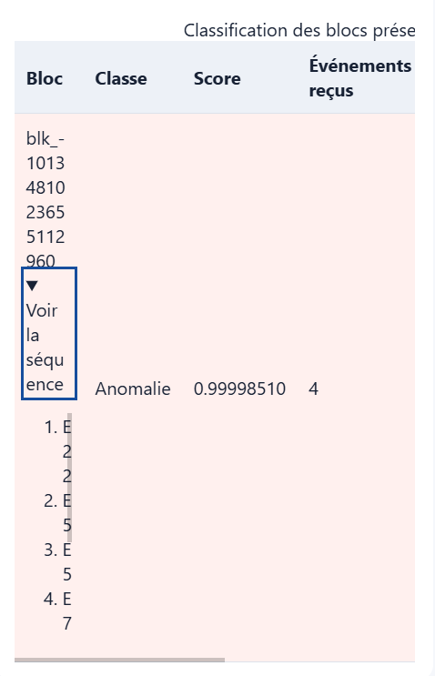
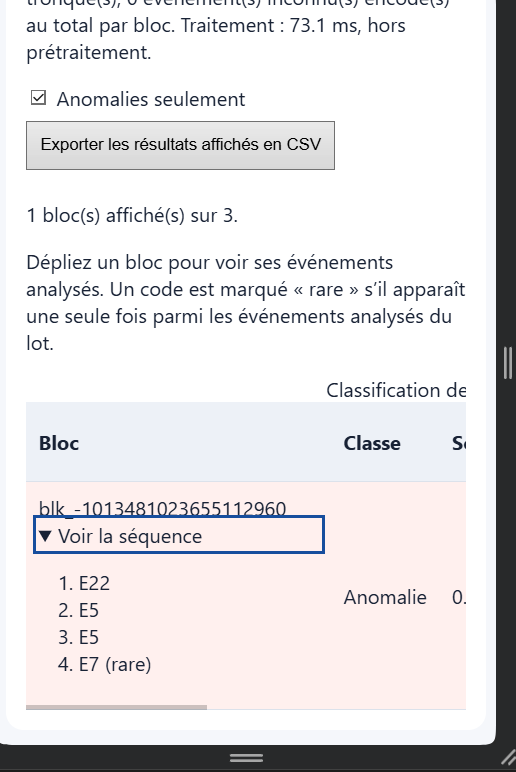

## Vérification mobile à 390 px

Avant la correction, la colonne Bloc coupait les codes des événements.

Après la correction, la séquence et la mention E7 (rare) sont lisibles.

Les tests avec des utilisateurs externes restent à réaliser.